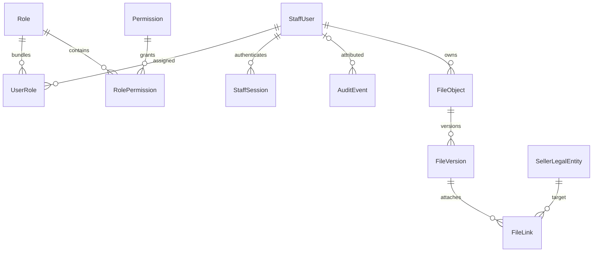

# R1-002 — модель сотрудников и базовых данных

**Статус: FROZEN. Версия: 1.0.0. Владелец контракта: ведущий интегратор.**

Источник полей/ключей/индексов для автоматической проверки — [R1-002-data-model.json](R1-002-data-model.json). Никакая реальная Prisma schema или миграция здесь не создаётся. Содержимое утверждено владельцем на SHA 867184f60d5306b58dd66ac6607a6ec0487761d3. Реализация относится к отдельной R1-002B; production-миграции не разрешены.

Трассировка: ADM-01/03, REQ-04, основа QUOTE-03; решения №10,16,49,50,55,85. ADR-001/003/004 сохраняются. Все значения `values` превращаются в PostgreSQL CHECK, nullable указано явно. Типы приведены для PostgreSQL; Prisma mapping и ручные CHECK/partial indexes входят только в будущую проверяемую SQL-миграцию.

## Связи

## Общие правила

UUIDv4 CSPRNG; `timestamptz(6)` и UTC. Строки UTF-8; API не принимает неизвестные поля. Все FK RESTRICT. Физическое удаление сотрудников, ролей, продавцов, сессий, файлов и аудита через API отсутствует. Удаление строк связей UserRole/RolePermission допускается только транзакционной командой с аудитом. Version int32 > 0: compare-and-swap expectedVersion, +1 и updatedAt при изменении; no-op команды отдельно описаны в auth/RBAC контракте. Переполнение version — отказ, не сброс.

Совместимость с предварительной схемой spec/05: FileObject уточняется как логическая идентичность файла, а физические key/checksum/size принадлежат FileVersion. Это техническое уточнение PROPOSED по решению №55, сохраняющее неизменные оригиналы, версии и StoragePort, без изменения бизнес-решения. StaffMembership не создаётся: B не содержит клиентских организаций или иерархии сотрудников.

Email уникален навсегда в B: ASCII, trim, lower всей строки, без удаления +suffix/точек; поле emailNormalized имеет C collation UNIQUE. Одинаковый нормализованный email запрещён и у BLOCKED. Смена email не входит в B. Формат реквизитов проверяется как формат, не как подтверждение действительности/налогового статуса.

## Сущности

### StaffUser

Internal employee only; not a customer identity.

| Поле                   | PostgreSQL     | NULL | Дополнительно                                                |
| ---------------------- | -------------- | ---- | ------------------------------------------------------------ |
| id                     | uuid           | нет  | default: "application UUIDv4 from CSPRNG"                    |
| email                  | varchar(254)   | нет  | —                                                            |
| emailNormalized        | varchar(254)   | нет  | —                                                            |
| displayName            | varchar(120)   | нет  | —                                                            |
| passwordHash           | text           | нет  | —                                                            |
| passwordChangeRequired | boolean        | нет  | default: false                                               |
| state                  | text           | нет  | values: ["ACTIVE","BLOCKED"]                                 |
| authVersion            | integer        | нет  | default: 1                                                   |
| blockedAt              | timestamptz(6) | да   | —                                                            |
| version                | integer        | нет  | default: 1; check: "version > 0"                             |
| createdAt              | timestamptz(6) | нет  | default: "transaction_timestamp()"                           |
| updatedAt              | timestamptz(6) | нет  | default: "transaction_timestamp(); explicitly set on update" |

PK: id. UNIQUE: [["emailNormalized COLLATE C"]]. INDEX: [["state","id"]].

DB CHECK / integrity: `email = btrim(email); ASCII email syntax defined in auth contract`; `emailNormalized = lower(email COLLATE C)`; `passwordHash LIKE $argon2id$%; API/operator enforce PHC parameters and password policy`; `authVersion > 0`; `(state = BLOCKED) = (blockedAt IS NOT NULL)`; `displayName trimmed, length 1..120`.

Жизненный цикл/удаление: ACTIVE <-> BLOCKED; no hard-delete/email-reuse or email editing in B. Password change flag limits use; history retained.

Разрешённые действия: bootstrap/recover CLI; staff.users.create; staff.users.status.write; self password change. Чувствительность: passwordHash NEVER DTO/log; email/displayName staff.users.read or self only.

Расширение: Future modules reference stable id via FK; no departments/customer memberships now.

### Role

Editable permission bundle; name never authorizes.

| Поле      | PostgreSQL     | NULL | Дополнительно                                                |
| --------- | -------------- | ---- | ------------------------------------------------------------ |
| id        | uuid           | нет  | default: "application UUIDv4 from CSPRNG"                    |
| code      | varchar(64)    | нет  | —                                                            |
| name      | varchar(120)   | нет  | —                                                            |
| state     | text           | нет  | values: ["ACTIVE","ARCHIVED"]                                |
| version   | integer        | нет  | default: 1; check: "version > 0"                             |
| createdAt | timestamptz(6) | нет  | default: "transaction_timestamp()"                           |
| updatedAt | timestamptz(6) | нет  | default: "transaction_timestamp(); explicitly set on update" |

PK: id. UNIQUE: [["code"]]. INDEX: [["state","id"]].

DB CHECK / integrity: `code matches ^[a-z][a-z0-9.-]{1,63}$`; `name trimmed, length 1..120`.

Жизненный цикл/удаление: Archive only when no UserRole references remain; no delete. No automatic permissions for future modules.

Разрешённые действия: staff.roles.write; staff.roles.permissions.write. Чувствительность: Bundle definitions require staff.roles.read.

Расширение: Add registered action codes in later contracts; no wildcard/role-name bypass.

### Permission

Registered named action, not a job title.

| Поле        | PostgreSQL     | NULL | Дополнительно                             |
| ----------- | -------------- | ---- | ----------------------------------------- |
| id          | uuid           | нет  | default: "application UUIDv4 from CSPRNG" |
| code        | varchar(80)    | нет  | —                                         |
| description | varchar(240)   | нет  | —                                         |
| createdAt   | timestamptz(6) | нет  | default: "transaction_timestamp()"        |

PK: id. UNIQUE: [["code"]]. INDEX: [].

DB CHECK / integrity: `code matches ^[a-z][a-z0-9]*(\.[a-z][a-z0-9]*)+$`.

Жизненный цикл/удаление: Insert by reviewed registry migration only; no public CRUD/update/delete.

Разрешённые действия: reviewed migration seed. Чувствительность: внутренний справочник, без секретов.

Расширение: New action has default deny; never auto-grant through existing role name.

### UserRole

One current assignment of a bundle to an employee.

| Поле             | PostgreSQL     | NULL | Дополнительно                                                          |
| ---------------- | -------------- | ---- | ---------------------------------------------------------------------- |
| staffUserId      | uuid           | нет  | references: "StaffUser.id"; onDelete: "RESTRICT"; onUpdate: "RESTRICT" |
| roleId           | uuid           | нет  | references: "Role.id"; onDelete: "RESTRICT"; onUpdate: "RESTRICT"      |
| assignedByUserId | uuid           | да   | references: "StaffUser.id"; onDelete: "RESTRICT"; onUpdate: "RESTRICT" |
| createdAt        | timestamptz(6) | нет  | default: "transaction_timestamp()"                                     |

PK: staffUserId, roleId. UNIQUE: []. INDEX: [["roleId","staffUserId"]].

DB CHECK / integrity: FK и composite PK.

Жизненный цикл/удаление: Insert/remove through guarded transaction; removal retained in audit. Referenced user/role not deleted.

Разрешённые действия: staff.roles.assign. Чувствительность: Assignment read requires staff.users.read; role definitions staff.roles.read.

Расширение: No seller scope implied. Future scoped assignment must be a new explicit contract.

### RolePermission

One action included in one bundle.

| Поле         | PostgreSQL     | NULL | Дополнительно                                                           |
| ------------ | -------------- | ---- | ----------------------------------------------------------------------- |
| roleId       | uuid           | нет  | references: "Role.id"; onDelete: "RESTRICT"; onUpdate: "RESTRICT"       |
| permissionId | uuid           | нет  | references: "Permission.id"; onDelete: "RESTRICT"; onUpdate: "RESTRICT" |
| createdAt    | timestamptz(6) | нет  | default: "transaction_timestamp()"                                      |

PK: roleId, permissionId. UNIQUE: []. INDEX: [["permissionId","roleId"]].

DB CHECK / integrity: FK и composite PK.

Жизненный цикл/удаление: Replace exact set with optimistic version and audit; row removal allowed, history in audit.

Разрешённые действия: staff.roles.permissions.write. Чувствительность: staff.roles.read.

Расширение: Only registered permissions; absent codes never authorize.

### StaffSession

Opaque employee browser session, PostgreSQL authority.

| Поле               | PostgreSQL     | NULL | Дополнительно                                                          |
| ------------------ | -------------- | ---- | ---------------------------------------------------------------------- |
| id                 | uuid           | нет  | default: "application UUIDv4 from CSPRNG"                              |
| staffUserId        | uuid           | нет  | references: "StaffUser.id"; onDelete: "RESTRICT"; onUpdate: "RESTRICT" |
| tokenHash          | bytea          | нет  | bytes: 32                                                              |
| authVersion        | integer        | нет  | —                                                                      |
| absoluteExpiresAt  | timestamptz(6) | нет  | —                                                                      |
| idleTimeoutSeconds | integer        | нет  | default: 1800                                                          |
| lastSeenAt         | timestamptz(6) | нет  | —                                                                      |
| revokedAt          | timestamptz(6) | да   | —                                                                      |
| revocationReason   | varchar(64)    | да   | —                                                                      |
| createdAt          | timestamptz(6) | нет  | default: "transaction_timestamp()"                                     |

PK: id. UNIQUE: [["tokenHash"]]. INDEX: [["staffUserId","revokedAt"],["absoluteExpiresAt"]].

DB CHECK / integrity: `octet_length(tokenHash) = 32`; `authVersion > 0`; `idleTimeoutSeconds BETWEEN 60 AND 43200`; `createdAt <= lastSeenAt AND lastSeenAt < absoluteExpiresAt`; `absoluteExpiresAt > createdAt`; `(revokedAt IS NULL) = (revocationReason IS NULL)`; `revokedAt IS NULL OR revokedAt >= createdAt`.

Жизненный цикл/удаление: Create at login/own password rotation. Revoke only, no restore. No physical cleanup before separately approved retention policy.

Разрешённые действия: auth login/logout; staff.sessions.revoke; security mutation invalidation. Чувствительность: tokenHash, session id and timestamps not exposed as credentials; no raw token/IP/user-agent persisted.

Расширение: No customer quote capabilities or JWT in this table.

### SellerLegalEntity

Our own selling OOO/IP, never a buyer.

| Поле         | PostgreSQL     | NULL | Дополнительно                                                |
| ------------ | -------------- | ---- | ------------------------------------------------------------ |
| id           | uuid           | нет  | default: "application UUIDv4 from CSPRNG"                    |
| displayName  | varchar(160)   | нет  | —                                                            |
| legalName    | varchar(500)   | да   | —                                                            |
| kind         | text           | нет  | values: ["OOO","IP"]                                         |
| inn          | varchar(12)    | да   | —                                                            |
| kpp          | varchar(9)     | да   | —                                                            |
| ogrn         | varchar(15)    | да   | —                                                            |
| legalAddress | varchar(1000)  | да   | —                                                            |
| state        | text           | нет  | values: ["DRAFT","ACTIVE","ARCHIVED"]                        |
| archivedAt   | timestamptz(6) | да   | —                                                            |
| version      | integer        | нет  | default: 1; check: "version > 0"                             |
| createdAt    | timestamptz(6) | нет  | default: "transaction_timestamp()"                           |
| updatedAt    | timestamptz(6) | нет  | default: "transaction_timestamp(); explicitly set on update" |

PK: id. UNIQUE: [["inn WHERE inn IS NOT NULL"]]. INDEX: [["state","id"]].

DB CHECK / integrity: `INN null or 10 ASCII digits for OOO / 12 for IP`; `KPP null or 9 ASCII digits for OOO; must be null for IP`; `OGRN null or 13 ASCII digits for OOO / 15 for IP`; `ACTIVE requires nonblank legalName and INN`; `(state = ARCHIVED) = (archivedAt IS NOT NULL)`; `displayName trimmed length 1..160`.

Жизненный цикл/удаление: DRAFT -> ACTIVE -> ARCHIVED; ACTIVE -> DRAFT allowed only before future domain references exist. B has no such modules. ARCHIVED is terminal; no delete.

Разрешённые действия: sellers.write. Чувствительность: Only sellers.read/write; no public legal-data endpoint.

Расширение: No invented tax/bank defaults. Structured tax/bank configuration and quote snapshots belong to later approved costing/quote contracts; ACTIVE here is not quote-ready.

### AuditEvent

Append-only minimal security/admin history.

| Поле          | PostgreSQL     | NULL | Дополнительно                                                                                         |
| ------------- | -------------- | ---- | ----------------------------------------------------------------------------------------------------- |
| id            | uuid           | нет  | default: "application UUIDv4 from CSPRNG"                                                             |
| occurredAt    | timestamptz(6) | нет  | default: "transaction_timestamp()"                                                                    |
| actorKind     | text           | нет  | values: ["STAFF","ANONYMOUS","OPERATOR"]                                                              |
| actorUserId   | uuid           | да   | references: "StaffUser.id"; onDelete: "RESTRICT"; onUpdate: "RESTRICT"                                |
| operatorLabel | varchar(80)    | да   | —                                                                                                     |
| action        | varchar(80)    | нет  | —                                                                                                     |
| entityType    | text           | да   | values: ["StaffUser","Role","StaffSession","SellerLegalEntity","FileObject","FileVersion","FileLink"] |
| entityId      | uuid           | да   | —                                                                                                     |
| outcome       | text           | нет  | values: ["SUCCESS","DENIED","FAILURE"]                                                                |
| reasonCode    | varchar(64)    | да   | —                                                                                                     |
| requestId     | uuid           | нет  | —                                                                                                     |
| sourceHash    | bytea          | да   | bytes: 32                                                                                             |
| changes       | jsonb          | нет  | default: "{}"                                                                                         |

PK: id. UNIQUE: []. INDEX: [["occurredAt DESC","id DESC"],["actorUserId","occurredAt DESC"],["entityType","entityId","occurredAt DESC"],["requestId"]].

DB CHECK / integrity: `actorKind = STAFF iff actorUserId IS NOT NULL`; `operatorLabel IS NOT NULL iff actorKind = OPERATOR`; `(entityType IS NULL) = (entityId IS NULL)`; `sourceHash null or 32 bytes`; `jsonb_typeof(changes) = object AND octet_length(changes::text) <= 4096`; `audit_event_valid(action,outcome,reasonCode,changes) по R1-002-audit-registry.json`.

Жизненный цикл/удаление: No API update/delete. Runtime DB role INSERT/SELECT only; PostgreSQL trigger rejects UPDATE/DELETE/TRUNCATE for ordinary runtime role. FK RESTRICT preserves employee attribution.

Разрешённые действия: security/admin transaction insert; audit.read. Чувствительность: No password/credential token/PHC/credential hashes/cookies/raw IP/full request/requisites snapshots; allowlisted deltas and keyed account/source fingerprints only.

Расширение: entityType/id are historical labels, not a dereference/ACL capability; future modules register types/actions explicitly.

### FileObject

Stable logical file identity and conservative ownership.

| Поле             | PostgreSQL     | NULL | Дополнительно                                                          |
| ---------------- | -------------- | ---- | ---------------------------------------------------------------------- |
| id               | uuid           | нет  | default: "application UUIDv4 from CSPRNG"                              |
| ownerStaffUserId | uuid           | нет  | references: "StaffUser.id"; onDelete: "RESTRICT"; onUpdate: "RESTRICT" |
| displayName      | varchar(255)   | нет  | —                                                                      |
| visibility       | text           | нет  | values: ["PRIVATE","INTERNAL"]                                         |
| state            | text           | нет  | values: ["ACTIVE","ARCHIVED"]                                          |
| version          | integer        | нет  | default: 1; check: "version > 0"                                       |
| createdAt        | timestamptz(6) | нет  | default: "transaction_timestamp()"                                     |
| updatedAt        | timestamptz(6) | нет  | default: "transaction_timestamp(); explicitly set on update"           |

PK: id. UNIQUE: []. INDEX: [["ownerStaffUserId","state","id"]].

DB CHECK / integrity: `displayName metadata only, no slash/backslash/control characters; length 1..255`.

Жизненный цикл/удаление: Metadata fixtures only in B. No HTTP writes/delete. Future archive preserves versions and originals.

Разрешённые действия: fixture only; future domain command requires new contract. Чувствительность: files.metadata.read AND object policy; no raw storage paths.

Расширение: Future nonstaff ownership requires explicit schema/policy change, not nullable-owner => public.

### FileVersion

Immutable physical blob/version of a logical file.

| Поле             | PostgreSQL     | NULL | Дополнительно                                                           |
| ---------------- | -------------- | ---- | ----------------------------------------------------------------------- |
| id               | uuid           | нет  | default: "application UUIDv4 from CSPRNG"                               |
| fileObjectId     | uuid           | нет  | references: "FileObject.id"; onDelete: "RESTRICT"; onUpdate: "RESTRICT" |
| number           | integer        | нет  | —                                                                       |
| storageKey       | varchar(128)   | нет  | —                                                                       |
| sha256           | bytea          | нет  | bytes: 32                                                               |
| sizeBytes        | bigint         | нет  | —                                                                       |
| mimeType         | varchar(127)   | нет  | —                                                                       |
| originalFilename | varchar(255)   | нет  | —                                                                       |
| safetyState      | text           | нет  | values: ["UNCHECKED"]                                                   |
| createdByUserId  | uuid           | нет  | references: "StaffUser.id"; onDelete: "RESTRICT"; onUpdate: "RESTRICT"  |
| createdAt        | timestamptz(6) | нет  | default: "transaction_timestamp()"                                      |

PK: id. UNIQUE: [["fileObjectId","number"],["storageKey"],["id","fileObjectId"]]. INDEX: [["fileObjectId","createdAt"]].

DB CHECK / integrity: `number > 0`; `sizeBytes BETWEEN 0 AND 9007199254740991`; `octet_length(sha256) = 32`; `storageKey matches ^[a-f0-9]{64}$; opaque random key, not content hash/path`; `originalFilename same safe-name rules as FileObject.displayName`; `mimeType matches a bounded type/subtype syntax`.

Жизненный цикл/удаление: Append-only; SQL trigger forbids UPDATE/DELETE for runtime role. No bytes/scan/upload/download actions in B; UNCHECKED never downloadable.

Разрешённые действия: fixture only; future authorized StoragePort.write. Чувствительность: storageKey never DTO/log; checksum/size/mime visible only after object policy.

Расширение: StoragePort returns key/size/sha256; verify persisted metadata against bytes in future domain transaction/compensation contract.

### FileLink

Typed attachment to an existing own seller only.

| Поле                | PostgreSQL     | NULL | Дополнительно                                                                  |
| ------------------- | -------------- | ---- | ------------------------------------------------------------------------------ |
| id                  | uuid           | нет  | default: "application UUIDv4 from CSPRNG"                                      |
| fileObjectId        | uuid           | нет  | references: "FileObject.id"; onDelete: "RESTRICT"; onUpdate: "RESTRICT"        |
| fileVersionId       | uuid           | нет  | references: "FileVersion.id"; onDelete: "RESTRICT"; onUpdate: "RESTRICT"       |
| sellerLegalEntityId | uuid           | нет  | references: "SellerLegalEntity.id"; onDelete: "RESTRICT"; onUpdate: "RESTRICT" |
| visibility          | text           | нет  | values: ["INTERNAL"]                                                           |
| createdByUserId     | uuid           | нет  | references: "StaffUser.id"; onDelete: "RESTRICT"; onUpdate: "RESTRICT"         |
| createdAt           | timestamptz(6) | нет  | default: "transaction_timestamp()"                                             |

PK: id. UNIQUE: [["sellerLegalEntityId","fileVersionId"]]. INDEX: [["fileObjectId","sellerLegalEntityId"]].

DB CHECK / integrity: `COMPOSITE FK (fileVersionId,fileObjectId) -> FileVersion(id,fileObjectId) ON DELETE/UPDATE RESTRICT`; `no generic entityType/entityId or arbitrary ACL JSON`.

Жизненный цикл/удаление: B fixtures/read only; no HTTP link writes/delete. Future unlink preserves audit, immutable-version refs.

Разрешённые действия: fixture only; future domain command. Чувствительность: Not directly enumerable; object policy checks seller access and restrictive file visibility.

Расширение: Future typed target FKs require a reviewed XOR constraint and domain policy; do not link unimplemented entities.

## Гарантии PostgreSQL и транзакций

PK/FK/UNIQUE/CHECK/partial unique indexes, append-only triggers и runtime table grants проверяются отрицательными прямыми SQL тестами под runtime DB role. CHECK не обращается к другим строкам: последнего пригодного control-admin и full-admin (все 12 явно зафиксированных базовых прав по собственному ACTIVE-role union, не имени роли), а также запрет self-grant обеспечивает единая NestJS/CLI транзакция с общим pg_advisory_xact_lock(1398031445, 2), повторным вычислением прав и чтением всех затронутых пользователей/ролей. Этот lock используют все штатные writers состояния/назначений/состава роли/пароля/passwordChangeRequired и registry. READ COMMITTED: lock до чтения actor/invariant state, результирующие оба набора проверяются перед commit; потеря последнего full-admin ->409 LAST_ADMIN_REQUIRED и rollback строк/версий/сессий с отдельным DENIED audit. Прямой SQL оператор с правами migration owner — отдельная доверенная административная граница, не API обход. FK и append-only audit не исчезают от удаления сотрудника.

Ревизии FileVersion неизменяемы SQL trigger и runtime grants. Composite FK запрещает связывать версию другого FileObject. Идемпотентное повторное назначение существующей роли не пишет аудит и не увеличивает version; повторное снятие отсутствующей роли также no-op при актуальном expectedVersion. Остальные PATCH с теми же данными — 200 без изменений; конфликт версии проверяется до no-op.

Audit entityType/id — историческая ссылка, не generic ACL/полиморфный FK. Нельзя переходить по ней к произвольному объекту без его policy. FileLink, наоборот, имеет настоящий типизированный FK только на существующий SellerLegalEntity.

## Первая миграция — план, НЕ SQL

1. B добавляет Prisma client/adapter совместимых pinned версий ADR-001, generator и эти 11 моделей; один владелец apps/api. Review-generated SQL дополнить CHECK, C-collation unique email, partial INN index, append-only triggers и grants.

2. Первый SQL migration явно обёрнут `BEGIN`/`COMMIT`; Prisma7 не предоставляет неявную гарантию transaction rollback. Никаких CREATE INDEX CONCURRENTLY/операций вне transaction. Fault-injection после промежуточного CREATE TABLE/seed обязан доказать rollback всех бизнес-DDL/seed; metadata записи Prisma о failed migration диагностируются отдельно, не скрываются resolve/reset. Один ordered migration создаёт таблицы, constraints/indexes и реестр 12 permissions; обычную bootstrap-admin роль/RolePermission можно seed в той же migration с детерминированными техническими UUID, но без StaffUser/UserRole/секретов. UserRole bootstrap появляется лишь по явной CLI команде. Seed permission/role не даёт доступ без сотрудника и сессии. Роль не получает будущие права автоматически.

3. До migration оператор/test harness явно provision-ит существующую ограниченную роль `stdu_runtime` с новым случайным secret вне Git; migration SQL выдаёт grants только этой роли. В изолированном test PG instance то же имя, без затрагивания чужого PG/ролей. MIGRATION_DATABASE_URL у CLI содержит operator identity; DATABASE_URL у приложения — stdu_runtime. Startup роль/пользователей не создаёт. Runtime DB role отдельно от migration owner: только нужные SELECT/INSERT/UPDATE и DELETE связей; Audit INSERT/SELECT, FileVersion INSERT/SELECT. Migration operator выдаёт ограниченные grants; учётные данные не выдумывать/не в Git. CLI использует runtime бизнес-команды, а не ALTER/суперпользователя.

4. Пустая изолированная test DB: explicit migrate deploy, constraints/catalog assert, bootstrap через скрытый ввод случайного пароля в одноразовом fixture процессе; никаких штатных аккаунтов/паролей в миграции. Повторный migrate deploy не меняет таблицы, данные или audit.

5. Заполненная test DB: отдельная одноразовая БД с unrelated sentinel table в отдельной схеме `fixture_sentinel`, исключённой из Prisma target `public`, до первой миграции (нет существующей бизнес-схемы у baseline); сравнить sentinel count/content/checksum. Затем заполнить все 11 таблиц fixtures, повторить deploy и сверить все UUID/FK/count/checksums. Не применять первую миграцию поверх конфликтующих таблиц: preflight drift -> STOP, отдельное решение о baseline, без reset/resolve для сокрытия drift.

6. Проверить audit rollback fault injection, ограничения напрямую SQL и конкурентные last-admin/self-grant сценарии. Production не затрагивается; destructive rollback отсутствует. В B стратегия ошибки: откат транзакции миграции, restore отдельной проверенной копии по решению оператора, не DROP/RESET. Применение только отдельной явной командой, не startup/health/автодеплой.

## Файлы — граница B

Бизнес-команд записи метаданных и StoragePort adapter в B нет: fixtures проверяют только модель и read policy. GET metadata возвращает id, ownerStaffUserId, displayName, visibility, state, версии id/number/sha256(hex)/sizeBytes/mimeType/originalFilename/safetyState/createdAt. Без storageKey/путей, без байтов. B всегда UNCHECKED, download endpoint отсутствует. Будущий download потребует одновременно действующую сессию/узкую capability, action permission, сохранённого владельца/typed domain-link, совпадения file+version, visibility, разрешённого scan-state и доменного разрешения; знать UUID/StoragePort key недостаточно. PRIVATE не открывается из-за seller link. Объектный policy применяется до чтения версий. Ни public volume, ни URL файла в DTO.

Сроки удаления/обезличивания персональных данных и хранения audit/file/session требуют решения владельца до production; B автоматически ничего не чистит и не заявляет бессрочную законность хранения.

Нормативный finite action/reason/outcome/changes registry: [R1-002-audit-registry.json](R1-002-audit-registry.json); StaffSession.revocationReason ограничен его sessionRevocationReasons. Для security expiry/lastSeenAt используют clock_timestamp() после lock waits, не transaction timestamp. Bootstrap требует явный display-name, а write-операции без read permission возвращают только id/version acknowledgment; полные DTO требуют отдельного read или self policy.
