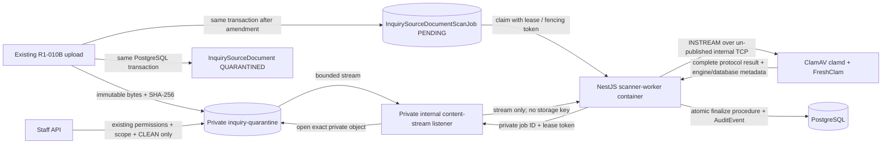

# R1-010D-01 — Malware Scanner Architecture & Security Contract

**Status:** PROPOSED / OWNER APPROVAL REQUIRED. This is an amendment proposal, not a frozen contract. 
**Contract revision proposed:** 0.1.0-proposed. 
**Baseline:** origin/main 81b76b5b084a0ef656c190ca63f9f71f93f092ba. 
**Task:** R1-010D — malware scanning and quarantine processing. 
**Delivery:** REVIEW_REQUIRED. No implementation, migration, scanner provisioning, production migration or deployment is included.

## 1. Purpose and fixed boundaries

This proposal fills the missing malware-scanning stage for R1-010 source attachments. It extends R1-010 narrowly; it does not change R1-010A/B form fields, public DTOs, capability-only upload routes, upload limits, contact rules, staff permissions, accepted formats, lifecycle or decisions 1–108. FROZEN R1-002/R1-004/R1-006A/R1-007 and OD-010-01…05 remain unchanged.

Preserve these existing facts:

- Six Inquiry tables are frozen. InquirySourceDocument is the sole original-file record; there is no second file entity or storage provider.
- Accepted originals are immutable and start QUARANTINED, with storageKey, SHA-256 and exact size persisted.
- The allowed types remain PDF, CSV and XLSX. MVP_SAFE is 10 MiB/file; ENGINEERING_DOCUMENTS is 50 MiB/file. The server-selected profile remains immutable.
- Without an operational scanner, originals remain unavailable to staff and parsers. MIME, signature and structural validation are not malware clearance.
- Staff document download still requires existing Inquiry read scope, inquiries.documents.read, inquiries.documents.download and safetyState=CLEAN.
- No public scan endpoint, file URL, customer status/lookup route, external AV cloud, manual CLEAN, OCR, extraction, render, parser, order, quote or production action is added.

## 2. Existing integration points inspected

- apps/api/src/storage/private-file-storage.ts: openInquiryQuarantine(key) opens the opaque key only below the existing private inquiry-quarantine namespace; writeInquiryQuarantineOwned already writes owned originals. It streams bytes and wraps storage failures.
- apps/api/src/storage/storage.port.ts: generic StoragePort has only write/open and must not be broadened with a public abstraction. If needed after approval, add a typed internal quarantine scan read that exposes bounded streaming and same-open-object identity validation.
- apps/api/src/inquiries/inquiries.service.ts: downloadDocument applies current actor, permissions, assignment/read scope and CLEAN check before opening the original; it records the existing download audit. Keep this as the sole download boundary.
- apps/api/prisma/schema.prisma: InquirySourceDocument is immutable except safetyState; no scan job, attempt or lease exists.
- apps/api/prisma/migrations/20261026140000_inquiry_domain/migration.sql: guard permits only QUARANTINED → CLEAN|REJECTED|SCAN_ERROR and SCAN_ERROR → CLEAN|REJECTED. stdu_runtime has SELECT,INSERT but no UPDATE on inquiry_source_document; keep that restriction.
- docs/contracts/R1-010-inquiry-audit-registry.json: inquiry.document.scan_state_changed already exists for OPERATOR, with SCAN_CLEAN, SCAN_REJECTED, SCANNER_UNAVAILABLE, INTERNAL_ERROR and allowlisted state/version changes.
- infra/compose/compose.yaml and infra/compose/compose.r1-010b-test.yaml: production/base Compose is out of scope here; test Compose must be a new isolated file only after approval.

## 3. Recommended topology

Recommend ADR-005 option B: a dedicated NestJS scanner-worker container, concurrency 1, plus a separate ClamAV container. The worker has its own DB identity limited to the scan procedures and has no private-file volume. It requests the exact active job's source bytes over a private, non-published NestJS content-stream listener using the job ID and short-lived lease token. The API verifies that lease in PostgreSQL, opens the exact inquiry-quarantine object through the existing storage adapter and streams it; it never returns the storage key. The worker streams to clamd INSTREAM with backpressure and never buffers whole files. The ClamAV engine is outside both NestJS containers and the public/staff API process.

The worker has no file volume and does not receive storage keys. clamd receives no inquiry ID, capability, customer metadata or database connection; it receives only content bytes on the internal socket. The scanner result is never an authorization token. A healthy scanner does not widen staff permissions.

### Option comparison

| Criterion          | A: clamd container + backend worker                                              | B: dedicated worker container + clamd (recommended)                                                  |
| ------------------ | -------------------------------------------------------------------------------- | ---------------------------------------------------------------------------------------------------- |
| Storage boundary   | Existing API StoragePort; scan result finalizes through the API runtime          | No worker mount; API returns bytes only for a live lease; storage key stays inside the API process   |
| API memory/CPU     | Engine isolated; orchestration, streaming and finalization share the API process | Worker and engine have separate resource budgets; API still streams with bounded memory              |
| DB/business writes | API runtime identity can perform both HTTP actions and scan finalization         | Separate worker identity can claim/finalize; API identity can only authorize a live content stream   |
| Restart/retry      | Durable PostgreSQL row and expiring lease                                        | Same PostgreSQL model and recovery semantics                                                         |
| Network            | API ↔ clamd on internal network                                                  | Worker ↔ clamd and worker ↔ private API listener; no host-published scanner or content-stream port   |
| Operations         | Fewer services and no private stream protocol                                    | One additional worker, private listener, DB identity, operator-only retry identity and health checks |

A is simpler, but it shares scan-finalization authority with the HTTP process. B is recommended because a separate worker identity and job-scoped byte stream reduce the scanner's authority without mounting the shared storage volume. Do not add Redis/BullMQ/RabbitMQ for these jobs.

## 4. ClamAV/protocol proposal

### 4.1 Version and image policy

- Candidate engine: ClamAV clamd, current supported 1.4 LTS patch 1.4.6 as checked 2026-10-27. Candidate image: official Alpine-based `clamav/clamav` repository.
- Before implementation, re-check the official support matrix, fixed vulnerabilities, exact official image tag, platform manifest and digest. Pin a versioned image by immutable digest; never use floating latest, stable or unstable in release Compose.
- Prefer the official base image plus one dedicated persistent signature database volume for the scanner project; one FreshClam writer shares that DB with its own clamd. Do not share a writable DB volume across multiple FreshClam instances. Readiness is false until required DBs are loaded and current.
- FreshClam should check at most hourly (official documentation permits up to four checks/hour with its documented DNS/mirror settings). The proposed maximum signature age is 24 hours; if age cannot be determined, the database is absent, update failed or age exceeds the approved threshold, scanning is unavailable and no CLEAN transition is allowed.
- Open upstream user reports currently mention HTTP 403 from FreshClam for 1.4.6 and 1.5.4. These are reports, not a confirmed global outage; target VDS egress must be tested without repeated retries or mirror evasion. An update failure preserves quarantine and eventually raises an operational alert.

### 4.2 INSTREAM and result mapping

Use only framed zINSTREAM with a NUL terminator. Send bounded chunks, each with a 4-byte unsigned big-endian payload length, and one zero-length terminator after EOF. Respect Node stream backpressure and clamd StreamMaxLength; use one connection per file initially. Read reply records until clamd closes the connection. Unknown/multiple results, ERROR, premature close, missing final record, timeout, invalid framing or protocol/version mismatch are not clean.

Provisional limits for a 50 MiB maximum source file (must be verified against the pinned binary and boundary fixtures before freeze):

| Limit                    |           Proposed initial setting | Required interpretation                                                                                               |
| ------------------------ | ---------------------------------: | --------------------------------------------------------------------------------------------------------------------- |
| StreamMaxLength          |                             64 MiB | Includes framing headroom above a 50 MiB source; any size-limit error is incomplete, never CLEAN.                     |
| MaxFileSize              |                             64 MiB | Covers the original; any nested item above the bound must produce an explicit limit result or force fail-closed.      |
| MaxScanSize              |                            256 MiB | Caps decompressed/recursive total work; exceeding the limit is incomplete, never clean.                               |
| MaxRecursion             |                                 10 | Finite nested-container depth; any exceeded limit is incomplete.                                                      |
| MaxFiles                 |                   10,000 initially | Bounded nested entry count; verify exact pinned-version response and treat any limit signal as incomplete.            |
| PCREMaxFileSize          | 64 MiB, not lower than MaxFileSize | Avoid silently skipping PCRE rules for an otherwise scan-eligible individual file; test the pinned version.           |
| MaxScanTime              |                         120,000 ms | ClamAV documents this limit as applying to ZIP scans only; it is not the global deadline.                             |
| Worker absolute deadline |                        180 seconds | Covers stream, scan and reply; terminate the socket and do not finalize CLEAN on expiry.                              |
| AlertExceedsMax          |                                yes | A limit alert such as Heuristics.Limits.Exceeded.* means incomplete/SCAN_ERROR, not malware REJECTED and never CLEAN. |
| AlertEncrypted           |                                yes | An encrypted/unscannable document is SCAN_ERROR; do not treat no verdict as clean.                                    |

These are recommendations, not existing R1 limits. Do not disable recursion, file, expanded-size or time bounds to force a clean verdict. Version-specific tests must prove what MaxFiles, MaxScanTime, MaxFileSize, MaxScanSize, MaxRecursion, encrypted-document handling and PCRE limits actually return. If a bound can be silently skipped, it is not acceptable for a CLEAN verdict until a version/configuration gate closes that gap.

A FOUND response naming a normal detection is REJECTED. A configured limit/unsupported or encrypted heuristic is SCAN_ERROR/incomplete. Only exactly one complete stream: OK, after a complete object was sent and the reply stream closed cleanly, with valid current signatures and unchanged source identity, may request CLEAN. The worker stores no signature name or scanner response text.

### 4.3 Current version-specific uncertainty

As of 2026-10-27, an open upstream ClamAV report states that ClamAV 1.5.4 can drop an error from an embedded stream in an OLE2 Excel workbook and report the outer file OK; the reporter says 1.4.6 surfaced an alert. This is an unconfirmed upstream report, but it is directly relevant to nested Office content. Before enabling XLSX CLEAN, reproduce an equivalent generated fixture on the exact pinned image or document upstream resolution and add a regression test. If the pinned engine reports clean for an incomplete nested scan, gate XLSX to remain unavailable (SCAN_ERROR) until fixed. No AV engine makes CLEAN a guarantee of absence of all malware.

## 5. Proposed additive data/migration contract

### 5.1 Why one new table is needed

The six frozen tables contain no durable job reservation, lease, attempt count, backoff or result provenance. Using only safetyState=QUARANTINED cannot safely coordinate multiple worker processes or recover bounded attempts. Reusing Redis would make queue loss/persistence part of the security boundary. Recommend one new table and no message broker.

**Proposed new entity 7/7:** InquirySourceDocumentScanJob, one row per InquirySourceDocument (sourceDocumentId unique, FK ON DELETE RESTRICT). No attempt-history table is added; capped attempt count and latest safe failure code live on the job row, detailed transition audit uses the existing append-only AuditEvent, and per-attempt diagnostics are sanitized logs/metrics.

Proposed columns:

- identity/binding: id, sourceDocumentId, sourceStorageKey (opaque internal snapshot), sourceSha256 (32 bytes), sourceSizeBytes (>0); compare all of these to the immutable source row when claiming and finalizing;
- control: status = PENDING|LEASED|RETRY_WAIT|COMPLETE|STOPPED, attemptCount (0…5), version (>0), availableAt, createdAt, updatedAt, nullable completedAt;
- lease: nullable leaseTokenHash (32 bytes), leaseExpiresAt; both null or both set; proposed fixed lease 240 seconds, with one 180-second absolute stream/scan deadline and 60 seconds for abort/finalize; no lease renewal; never log/return the raw token except once to the claiming worker;
- last safe failure/provenance: nullable enum failureCode (no arbitrary text), engineVersion, signatureDatabaseVersion, signatureDatabaseDate, lastAttemptAt and lastScanDurationMs.

Constraints and indexes:

- unique sourceDocumentId; FK RESTRICT; SHA byte length 32; positive size/version; nonnegative attempts; valid status/failure enums;
- lease hash/expiry are paired; non-LEASED rows have no active lease; completed/STOPPED rows cannot be claimed except through the explicit retry transition;
- queue index (status, availableAt, createdAt, id) and lease-expiry index (status, leaseExpiresAt, id);
- immutable source descriptor snapshot is never rewritten; only job scheduler fields/version/provenance update under the database procedures;
- no raw file, user, customer, filename, source address, capability, scanner payload or signature string is stored in the job.

### 5.2 Procedures and privileges

Propose four narrowly scoped SQL procedures, owned by a non-login migration owner, hardened with a fixed search_path, REVOKE EXECUTE FROM PUBLIC, input validation, row locks and explicit grants:

1. inquiry_scan_claim: the worker generates a cryptographically random 256-bit token and passes only its SHA-256 to the function. The function atomically selects an eligible row with FOR UPDATE SKIP LOCKED; claims pending/due retry or an expired lease only while the attempt cap permits; checks source identity/state and job/source snapshot; stores the token hash, increments bounded attempt/version, and returns only job ID, source document ID, expected SHA-256/size, allowed profile limit, job version and lease expiry. It never returns storageKey or raw token. The raw token remains in worker memory. A claim response contains no file bytes, filename, customer metadata or storage path. A PENDING job with source QUARANTINED is eligible for normal processing; source SCAN_ERROR is eligible only after the operator retry procedure placed that STOPPED job back in PENDING. The claim transaction writes one job-control audit event. Once a final attempt's lease expires without a result, a subsequent claim call atomically stops that job and writes the job-control audit; it moves the source to SCAN_ERROR and writes the source-state audit only if the source was still QUARANTINED. It does not claim a sixth attempt.
2. inquiry_scan_read_authorized: callable by the API runtime role only. It validates a supplied job ID and lease-token hash against the current unexpired lease and returns only the bound source descriptor/storage key to the API process. The private internal listener uses it before opening the object; the descriptor and storage key never go to the worker or logs.
3. inquiry_scan_finalize: callable by the separate worker role only. Under a lock it compares the source row to the immutable job snapshot (including storage key, SHA and size), checks expected source state, job version, lease-token hash and unexpired lease; accepts only a typed scanner result plus the worker-observed SHA-256/size; atomically updates safetyState through the existing transition guard, completes/stops/reschedules the job and inserts the allowlisted audit event. The worker never supplies or receives a storage key. On PostgreSQL/audit failure, nothing changes; lease expiry permits retry. A repeated call for an already completed job is a no-write idempotent replay; a stale lease or conflicting attempt cannot add another state transition or audit row.
4. inquiry_scan_retry: callable only through a separately controlled operator principal, never by the worker or public/staff API. It requires expected job version and STOPPED/SCAN_ERROR, records the operator's bounded reason, starts a new bounded attempt cycle by resetting only its cycle attempt count, increments the monotonic job version, sets PENDING while leaving the source in SCAN_ERROR, and writes a job-control audit event. Concurrent calls with the same expected version allow at most one retry; the loser has no state or audit mutation. It cannot accept a verdict, modify source state or set CLEAN. No new business RBAC permission is introduced. The database audit attribution is the controlled service/operator label; it is not a claim that an authenticated StaffUser performed the action.

The separate worker DB role receives EXECUTE only on claim/finalize; the API runtime role receives EXECUTE only on read-authorization; a separately controlled operator DB principal receives EXECUTE only on retry. None receives direct UPDATE on InquirySourceDocument or the scan job. The worker role cannot query unrelated business data; the API cannot finalize a scan or retry a stopped job; the operator principal cannot claim, read file content, finalize or query unrelated business data. If the repository's migration-role model cannot securely create this boundary, implementation stops for a revised DB design; no broad table grant is allowed. Functions never bypass staff download authorization.

### 5.3 Job lifecycle

1. The existing successful upload-completion transaction inserts InquirySourceDocument(QUARANTINED), consumes the intent, stores the existing receipt/audit and creates one PENDING scan job atomically. The existing private blob write/compensation behavior remains unchanged.
2. One worker service claims at most one job. The DB claim function serializes claims even if duplicate worker processes start.
3. The worker checks the server-selected immutable profile limit, exact metadata, clamd readiness, engine/database versions and approved signature age before requesting bytes. Missing/quarantined/mismatched files, missing signatures or stale versions never proceed to a clean result.
4. The worker calls the private content-stream listener with job ID in a bounded request body and the lease token in a redacted header. The listener is bound only to the task's private worker/API Docker network, absent from public OpenAPI/reverse proxy and has no host-published port. It validates the lease through inquiry_scan_read_authorized and streams the object from the existing private StoragePort; it accepts no storage key/path from the worker. The token is excluded from access, application, proxy and tracing logs. The worker has no Internet egress and connects only to PostgreSQL procedures, this listener and clamd; only the clamd/FreshClam service requires narrowly reviewed signature-update egress.
5. The API storage adapter opens one read handle and streams with backpressure while verifying the same handle's size/hash/identity against the immutable DB snapshot. The worker independently hashes/counts the received stream and enforces the profile ceiling; it does not send the final INSTREAM zero terminator until EOF and a matching digest/size. Any mismatch or premature stream close aborts the scan. No bytes are buffered as a whole file. Only the API process sees the storage key; only the API and worker process the file bytes; clamd sees the stream bytes only.
6. Finalize through the worker-only DB procedure using the same lease/version and one atomic transaction for source state, job result and AuditEvent.
7. If the worker crashes, lease expiry makes the job reclaimable while the bounded attempt budget remains. A stale worker has an old fencing token/version and cannot finalize after a new claim. The proposed 240-second lease is longer than the 180-second end-to-end stream/scan deadline by a 60-second abort/finalize margin; expiry is not extended by a slow or blocked worker.

### 5.4 States and failure policy

InquirySourceDocument.safetyState remains exactly the frozen enum. Allowed terminal path remains:

- QUARANTINED → CLEAN only after the full conclusive clean conditions above;
- QUARANTINED → REJECTED only after a complete malicious detection;
- QUARANTINED → SCAN_ERROR after a permanent/integrity failure or exhausted attempts;
- SCAN_ERROR → CLEAN|REJECTED only after explicit internal retry plus a new complete conclusive scan;
- CLEAN and REJECTED are terminal; there is no manual override or reclassification path. A STOPPED SCAN_ERROR may only be retried by the controlled operator path after the technical cause has been addressed; every new cycle remains bounded.

During transient retries, the source stays QUARANTINED (or stays SCAN_ERROR during an operator retry). Staff downloads remain denied in all non-CLEAN states. A disabled/unavailable scanner does not invent a result.

| Result/failure                                                                                                                             | Job behavior                                                                 | Source state                       | Download                                |
| ------------------------------------------------------------------------------------------------------------------------------------------ | ---------------------------------------------------------------------------- | ---------------------------------- | --------------------------------------- |
| Full stream: OK, all identity/freshness/limit checks pass                                                                                  | COMPLETE                                                                     | CLEAN                              | Existing permission/scope boundary only |
| Confirmed malware detection                                                                                                                | COMPLETE                                                                     | REJECTED                           | Denied                                  |
| Temporary scanner outage, temporary stale signatures, network timeout, interrupted stream, DB/audit transaction failure                    | RETRY_WAIT with bounded backoff; never store a clean verdict                 | QUARANTINED or existing SCAN_ERROR | Denied                                  |
| Unknown protocol/result/version, absent DB, file missing, SHA/size/key mismatch, limit exceeded, encrypted/unsupported/unscannable content | STOPPED immediately or after bounded retries only where classified transient | SCAN_ERROR                         | Denied                                  |
| Five failed attempts                                                                                                                       | STOPPED; explicit operator retry required after correction                   | SCAN_ERROR                         | Denied                                  |

Recommended attempts: 5 per cycle. Recommended delays after failed attempts: 1, 5, 15 and 60 minutes, then set SCAN_ERROR and STOPPED. An explicit operator retry after remediation starts a new five-attempt cycle; the job version remains monotonic, retry is audited, and source state remains SCAN_ERROR until a new complete scan finalizes. Treat classifier and maximum as configuration pinned by the approved contract; do not retry endlessly. A DB failure after ClamAV returns is not a success; source/audit remain unchanged and the lease is later retried.

### 5.5 Source identity and TOCTOU

The result is for the tuple (InquirySourceDocument.id, storageKey, sha256, sizeBytes, bytes actually streamed). No name/MIME-only match is sufficient. The source row and original are immutable; no write/replace API exists for an existing opaque key. The private API listener uses a typed openInquiryQuarantineForScan read handle that verifies the opened object identity and size/hash while streaming to the worker. The worker hashes/counts the bytes it receives and compares them to the DB snapshot before terminating INSTREAM; the worker-only finalize function then rechecks the descriptor snapshot, source state, job version and live lease in one transaction. A replacement after the API stream is not supported by the StoragePort contract; any observed identity/hash mismatch or storage error is SCAN_ERROR, not CLEAN.

Do not use a public URL, client-provided key, host filesystem path, or clamd path command. The storage method validates the exact quarantine namespace internally.

## 6. Audit and observability

- Existing `inquiry.document.scan_state_changed` remains the audit record only for actual terminal file-state transitions; source state, job outcome and AuditEvent commit together. The scanner service is attributed as actor kind OPERATOR with a fixed service label, not as a human staff member. SCAN_CLEAN, SCAN_REJECTED, SCANNER_UNAVAILABLE and INTERNAL_ERROR are the currently allowed reason codes. In this amendment, `version` is the monotonic scan-job version. Do not log/store raw ClamAV response or signature name.
- Propose one additive audit action `inquiry.document.scan_job_control_changed` for claim, automatic reschedule, attempt exhaustion and explicit operator retry. Actor kind OPERATOR with distinct fixed service labels for worker versus operator; bounded reason codes are SCAN_ATTEMPT_CLAIMED, SCAN_RETRY_SCHEDULED, SCAN_ATTEMPTS_EXHAUSTED and SCAN_OPERATOR_RETRY; outcome is SUCCESS; `changes` contains only the monotonic job `version`. It does not claim the file state changed. The checker/schema registry is extended only after this amendment is approved. Ordinary per-attempt telemetry does not create additional audit actions.
- Structured operational events: scan.started, scan.clean, scan.rejected, scan.failed, scan.retry_scheduled. Low-cardinality fields only: outcome code, attempt count, duration, engine/version, signature age and queue class. Do not include source document ID, Inquiry ID, file name, contact, IP, key, SHA, content, raw response or DB DSN.
- Metrics: pending/quarantined count, oldest queue age, duration histogram, terminal CLEAN/REJECTED/SCAN_ERROR counts, clamd readiness, engine version, signature age, retry count and active scans. No high-cardinality IDs or PII labels.
- Liveness is separate from readiness. PING proves daemon liveness only. Readiness requires protocol compatibility, signature databases loaded, parseable signature metadata within the approved age threshold, enough scratch capacity and no scanner OOM/unavailable signal.

## 7. Isolated test Compose proposal

After approval, add only infra/compose/compose.r1-010d-test.yaml:

- unique Compose project stdu-r1-010d-test and dedicated disposable PostgreSQL and private test storage; never attach to the shared dev/prod project or volumes;
- clamd port 3310, the worker and the private content-stream listener have no host-published ports. Private networks admit only the API, worker, clamd and PostgreSQL services that need each connection; the internal listener is reachable only by the worker network peer and is not routed by the public reverse proxy;
- only the API test container mounts/opens the test quarantine through the existing StoragePort implementation; the worker has no file volume and receives bytes only for a valid active lease; clamd gets no StoragePort mount and no DB credentials;
- API, worker and controlled retry operator use separate least-privilege DB identities; the worker cannot invoke operator retry;
- scanner image pinned to verified official digest for tests; test database volume is task-owned and isolated;
- proposed isolated test budget: clamd receives a 4 GiB memory reservation and an initial 6 GiB hard cap for reload/scan peak measurement, at least 1 vCPU, concurrency 1, bounded 512 MiB scratch and a persistent signature volume; the NestJS worker has a separate measured memory cap and cannot buffer whole files. The host needs these resources in addition to Next.js, API, PostgreSQL, Redis, FastAPI and OS. Host-level egress policy is not expressible as a Compose-only guarantee; production requires host firewall review. If resource or signature readiness fails, tests fail closed or report scanner unavailable; no fallback to mock CLEAN;
- test cleanup may remove only containers/networks/volumes bearing the exact disposable project identity after verifying ownership; never docker system prune, shared compose down, or production volume deletion.

## 8. Test and security matrix for R1-010D implementation

All files are generated test fixtures; EICAR is the standard harmless detection fixture. PostgreSQL is disposable, storage root separate, and no real customer files are used.

| ID      | Scenario                                                | Required evidence/result                                                                           | Planned verification                            |
| ------- | ------------------------------------------------------- | -------------------------------------------------------------------------------------------------- | ----------------------------------------------- |
| SCAN-01 | Generated safe PDF                                      | Full scan → CLEAN only when all strict conditions pass                                             | Real clamd + HTTP/DB                            |
| SCAN-02 | Generated safe CSV                                      | Full scan → CLEAN                                                                                  | Real clamd + HTTP/DB                            |
| SCAN-03 | Generated valid XLSX                                    | Full scan → CLEAN only for approved engine/version fixture set                                     | Real clamd + OOXML regression                   |
| SCAN-04 | EICAR fixture                                           | REJECTED; no file download                                                                         | Real clamd + DB + HTTP                          |
| SCAN-05 | clamd unavailable                                       | Retry/error, never CLEAN; download denied                                                          | Fake scanner + network outage                   |
| SCAN-06 | Worker hard timeout                                     | Socket closes, job bounded, never CLEAN                                                            | Short injected deadline + fake scanner          |
| SCAN-07 | Protocol error/unknown record                           | SCAN_ERROR or bounded retry; never CLEAN                                                           | Fake scanner protocol fixtures                  |
| SCAN-08 | Truncated input/reply                                   | No zero terminator/conclusive reply, never CLEAN                                                   | Stream/socket fixture                           |
| SCAN-09 | Scanner size/depth/file/time limit                      | Limit alert mapped incomplete, not malware-clean                                                   | Real clamd limit fixtures                       |
| SCAN-10 | 10 MiB and 50 MiB boundaries by profile                 | Exact profile maximum handled; one byte over rejected/error; no profile widening                   | Generated streamed exact/over-size fixtures     |
| SCAN-11 | SHA-256/size mismatch                                   | No state to CLEAN; integrity failure recorded safely                                               | Fake storage + PostgreSQL                       |
| SCAN-12 | Repeated/replayed claim or finalize                     | One stable job; same completion is a no-write replay; stale/conflicting result adds no state/audit | PostgreSQL transaction retry                    |
| SCAN-13 | Two worker processes claim same row                     | One live lease; stale fencing token cannot finalize                                                | Real PostgreSQL lock/block/final-state evidence |
| SCAN-14 | Process killed during scan                              | Lease expires; restart reclaims within attempt cap                                                 | Worker restart + PostgreSQL                     |
| SCAN-15 | PostgreSQL fails after scan result                      | No partial source/audit/job commit; retry after lease                                              | PostgreSQL fault injection                      |
| SCAN-16 | Runtime role direct update; worker tries operator retry | Both denied; only narrow finalize/retry procedures available to their principals                   | PostgreSQL privilege test                       |
| SCAN-17 | Staff missing download permission/scope                 | CLEAN still not downloadable                                                                       | Existing R1-010B runtime suite                  |
| SCAN-18 | QUARANTINED/REJECTED/SCAN_ERROR                         | Download denied                                                                                    | Existing and added runtime tests                |
| SCAN-19 | Unsupported engine/result/database version              | Readiness denied or SCAN_ERROR; never CLEAN                                                        | Fake version + pinned clamd smoke               |
| SCAN-20 | R1-010B upload/idempotency/audit/capability revocation  | Existing behavior and exact original preserved                                                     | Existing Inquiry runtime suite + regression     |

High-risk Postgres concurrency evidence must include blocked lock/lease behavior and final rows/audit, not only Promise timing or HTTP status. Add a real scanner smoke with generated PDF/CSV/XLSX and EICAR only after the isolated profile exists.

## 9. Resource and operational assessment

Official ClamAV documentation recommends 3 GiB+ RAM, 1 CPU at 2.0 GHz+ and 5 GiB free disk; its Docker guidance says 4 GiB is preferred and notes signature reload can temporarily load a second engine while FreshClam also consumes memory. Propose a 4 GiB clamd reservation and a 6 GiB hard cap for isolated peak measurement, at least 1 vCPU, one active scan, a separately capped streaming-only NestJS worker, 512 MiB scratch, and at least 5 GiB free for scanner/image/signature data before scratch and host headroom. These are test starting values, not evidence the current VDS can support them. Obtain actual VDS RAM/CPU/disk and observe update/reload plus scan peak before deciding production limits; if the host lacks measured headroom, leave scanning disabled and files quarantined.

ClamAV is signature/heuristic detection, not proof of benign content. A clean response means only that this exact byte stream completed under a specific engine/database/configuration with no reported detection/limit. Maintain all downstream format/parser bounds independently.

## 10. Owner decisions required

Approve or amend this exact proposed amendment before implementation:

- **OD-010D-01 — Topology.** B (dedicated scanner-worker container + separate clamd; recommended), with no storage volume in the worker and a private lease-bound API content stream; A (coordinator in the API container) remains the simpler alternative but shares runtime identity.
- **OD-010D-02 — Data/DB/audit amendment.** Add exactly one InquirySourceDocumentScanJob table (7th Inquiry-domain entity), four narrow DB procedures, separate API/worker/operator EXECUTE grants with no direct state UPDATE grants, one private non-published content-stream listener, and one additive job-control audit action. The worker cannot retry; the separate operator principal can only start a bounded retry cycle and cannot read bytes or set a verdict. Audit actor labels identify the controlled service/operator path, not an individual StaffUser. Keep all six frozen R1-010 tables, permissions and public APIs unchanged.
- **OD-010D-03 — Retry and freshness policy.** Approve 24-hour maximum signature age; 180-second end-to-end stream/scan deadline; fixed 240-second lease with 60-second cleanup/finalize margin and no renewal; five attempts per cycle with 1/5/15/60-minute backoff; after STOPPED/SCAN_ERROR, an explicitly audited operator retry starts a new bounded five-attempt cycle. These are proposed operational defaults, not frozen facts.
- **OD-010D-04 — Engine/version/content gate.** Approve official ClamAV 1.4.6 LTS patch as initial candidate, with digest pin at implementation; require a version-specific XLSX/OLE2/incomplete-scan regression gate and no CLEAN for any unsupported result. If upstream behavior is not reproducibly fail-closed, keep affected files quarantined until a patched build passes.
- **OD-010D-05 — Resource and update readiness.** Approve the isolated test starting budget of 4 GiB clamd reservation/6 GiB hard cap pending peak measurement, at least 1 vCPU, one active scan, a separately capped streaming-only worker, 512 MiB scratch, persistent single-writer signature volume, hourly update checks and host egress verification; do not enable on VDS until measured capacity and signature updates pass.

Approval authorizes later isolated implementation only. It does not authorize production migration, deployment, public launch, production data processing, a live scanner, permissions changes, or production use of received files. Production deployment remains separately gated.

## 11. Stage A verification and stop condition

This PR contains documentation and a checkpoint only. No app code, migration, DTO, RBAC grant, API route, Compose service or production setting changes. No fake scanner tests were added because the proposed DB job/finalization contract itself requires Owner Approval first.

After approval, Stage B should add a dedicated test:r1-010d command and run targeted adapter/DB tests, the complete SCAN-01…20 matrix, the existing R1-010B regression suite, full quality gate, independent backend/database/security/DevOps review, isolated real-clamd smoke and exact-HEAD GitHub CI. No production migration/deployment.

## 12. Sources

- [ClamD protocol: framing, INSTREAM, limits and replies](https://docs.clamav.net/manual/Usage/ClamdProtocol.html)
- [ClamAV Docker: resource use, images, FreshClam and signature volume behavior](https://docs.clamav.net/manual/Installing/Docker.html)
- [Official ClamAV Docker image repository](https://hub.docker.com/r/clamav/clamav)
- [ClamAV recommended system requirements](https://docs.clamav.net/)
- [ClamAV EOL and support matrix](https://docs.clamav.net/faq/faq-eol.html)
- [ClamAV FreshClam troubleshooting and update frequency](https://docs.clamav.net/faq/faq-troubleshoot.html)
- [Official clamd.conf settings and bounds](https://github.com/Cisco-Talos/clamav/blob/main/etc/clamd.conf.sample)
- [Upstream issue 1848: reported embedded OLE2 stream error](https://github.com/Cisco-Talos/clamav/issues/1848)
- [Upstream issue 1849: reported FreshClam 1.4.6 HTTP 403](https://github.com/Cisco-Talos/clamav/issues/1849)
- [Upstream issue 1851: reported FreshClam 1.5.4 HTTP 403](https://github.com/Cisco-Talos/clamav/issues/1851)
- [Upstream issue 1785: reported PCREMaxFileSize handling](https://github.com/Cisco-Talos/clamav/issues/1785)
