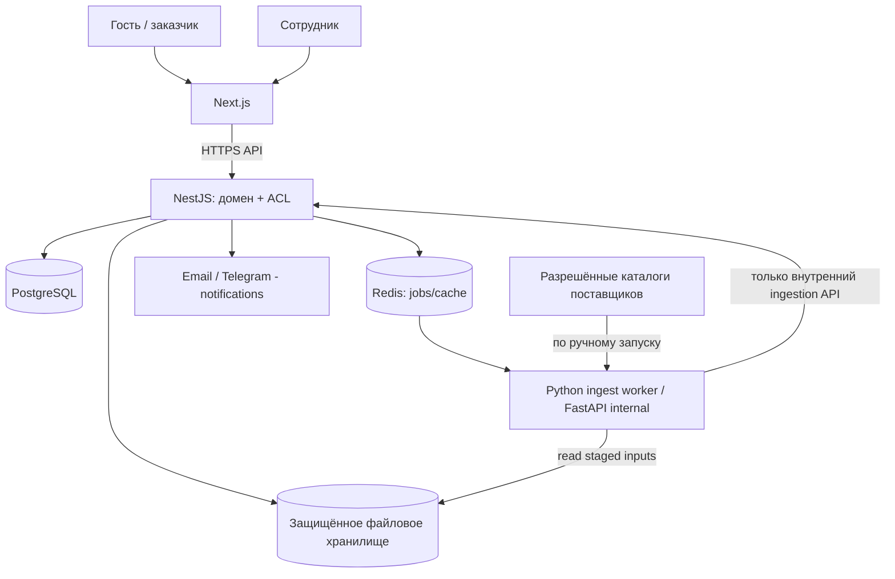

# Архитектура R1 — модульный монолит + изолированный Python ingestion

## 1. Главные архитектурные решения

- **Next.js**: публичный SSR/SEO-сайт, формы, защищённый просмотр КП, единая админка; UI не решает вопросы разрешений и расчёта авторитетных сумм.
- **NestJS (модульный монолит)**: единственный владелец доменных команд и транзакций, RBAC, версий, цен, КП, клиентского API.
- **Python/FastAPI + фоновые процессы**: контролируемое извлечение из Excel/CSV/PDF и разрешённых сайтов поставщиков; без права незаметной публикации данных.
- **PostgreSQL**: единственный транзакционный источник истины; миграциями распоряжается владелец схемы.
- **Redis**: очередь заданий, краткоживущий кэш/идемпотентность, не долговременное хранилище бизнеса.
- **Файлы**: локальная конфигурируемая защищённая директория тома сервера в R1 с единым `StoragePort`, чтобы позже заменить реализацию; обязательный внешний бэкап и контроль прав. Оригиналы и утверждённые снимки считаются неизменяемыми.
- **Deploy**: одна российская VDS/VPS, контейнеры Docker, HTTPS, изоляция внутреннего ingestion от интернета; внешние резервные копии и минимальный мониторинг. Не навязывать Kubernetes/микросервисы/managed-cloud.

Рекомендуется монорепозиторий; конкретные версии библиотек и пакетных менеджеров фиксируются первым архитектурным PR, а не предполагаются утверждёнными пользователем.

```text
b2b-platform/
├─ AGENTS.md
├─ apps/
│  ├─ web/                     # Next.js, публичные страницы + admin + quote portal
│  └─ api/                     # NestJS modules, Prisma/TypeORM (выбрать в ADR)
├─ services/
│  └─ ingestion/               # Python/FastAPI, parsers, spec extractors
├─ packages/
│  ├─ api-client/              # автогенерация из OpenAPI, не вручную
│  ├─ design-tokens/           # #172838, #177A83 и др.
│  └─ shared-config/           # только конфигурационные типы, без бизнес-логики
├─ infra/
│  ├─ compose/
│  └─ scripts/
├─ docs/
│  ├─ architecture/
│  ├─ contracts/
│  └─ plans/
└─ tests/
   ├─ fixtures/
   └─ e2e/
```

## 2. Logical diagram



У Python-компонента нет полномочия выставить `published=true` или `quote.approved=true`. Его выход — **кандидаты / сырой разбор / метаданные**. Доменные решения принимает NestJS после проверки прав сотрудника.

## 3. NestJS bounded contexts

| Модуль | Владеет | Не владеет |
|---|---|---|
| Identity/RBAC | учётные записи сотрудников, сессии, роли, разрешения, подтверждение org scopes | клиентские корпоративные кабинеты R2 |
| Organizations | собственные ООО/ИП, банковские реквизиты, налоговые настройки | раздельная собственность склада |
| Catalog | бренд, категория, атрибут, товар, фотографии и опубликованная цена | парсинг веб-сайта, резервы склада |
| SupplierOffers | поставщик, ручные предложения, связь предложений с SKU, происхождение цен | размещение закупочного заказа |
| Ingestion | источники, ручной запуск, журнал, кандидаты изменений, решения админа | самостоятельная публикация |
| Requests | заявки, состав запроса, контакты, источники, этапы/ответственные | клиентский заказ |
| Specifications | исходный документ, строки, разделы, результаты сопоставления, ревизии | выбор функционального аналога автоматически |
| Engineering | проверка, замечания, запросы уточнений, утверждённая редакция | независимый обязательный проверяющий |
| Pricing | калькуляции, коммерческие политики, стоимости, маржа, ручная логистика | бухгалтерский учёт |
| Quotations | КП, строки/секции, утверждение, иммутабельные редакции, PDF, защищённые ссылки, отклики | автоматический запуск заказа |
| Documents | файлы, версии, связи с объектами, безопасные выдачи | файловые пути из свободного input |
| Content/SEO | фиксированные шаблоны страниц, SEO | drag-and-drop CMS |
| Notifications | задания email/Telegram, доставка, повторные попытки | основной статус бизнес-объекта |
| Audit | события разрешённых бизнес-изменений | телеметрия производственного оборудования |

Каждый модуль использует свои доменные сервисы и репозитории; прямое изменение таблиц «чужого» модуля запрещено, кроме согласованных транзакционных интерфейсов. Внешний API стабилен и версионируется.

## 4. Точки расширения R2+ (НЕ реализовывать в R1)

- `QuoteInterestRecorded` → позднее `ClientOrderDraftCreated`; в R1 только сохранять интерес к КП.
- `CatalogItemId` будет стабильным FK для складских товаров, закупок, резервов, комплектаций.
- `OrganizationSellerId` используется уже в R1, поэтому будущие заказы наследуют точно того продавца, который указан в КП.
- `DocumentVersionId` закрепляется за редакциями КП; позднее — за производственными паспортами.
- `SpecificationRevisionId` пригоден и для калькуляции, и для будущего производственного BOM.
- `RequestId` → `QuoteId` → future `OrderId`, не моделировать весь order lifecycle до R2.
- Доменные события создаются с `event_id`, `occurred_at`, `aggregate_id`, `schema_version`; потребители будущих релизов могут на них подписаться без миграции всей модели.

## 5. API, события, контракты

- REST + JSON, документировать **OpenAPI** от NestJS; типизированный клиент web генерируется из OpenAPI при CI.
- Все команды с побочными эффектами авторизуются сервером, валидируются, записывают audit event. Для повторяемых POST, внешних обратных вызовов и фоновой записи поддержать `Idempotency-Key` либо эквивалент.
- `ingestion` принимает от API jobId с типом `supplier_catalog` или `customer_spec`. Фоновая задача сохраняет результат через internal service contract, не напрямую публикует каталог.
- Фоновые процессы имеют retry/backoff и dead-letter/error status, с идемпотентной обработкой одного jobId.
- Номер КП — отдельный человекочитаемый идентификатор; внутренние UUID не раскрывают последовательность клиентских заказов.
- Все даты в БД UTC плюс timezone для отображения/источника; деньги — decimal с явной валютой и налоговой базой; никакого JS float для итогов.

## 6. ADR, которые нужно зафиксировать перед кодом

1. ORM/миграции: Prisma или TypeORM; **единственный** владелец миграций — ведущий backend-агент.
2. Стратегия token/session auth для внутренних пользователей и токенов внешнего просмотра КП.
3. StoragePort: имена томов, безопасные имена объектов и стратегия резервного копирования.
4. CSV/XLSX/PDF parsing contracts: размер, encoding, правила разметки строк; fixture-набор.
5. Инструмент для очереди Redis, таймауты/ретраи/идемпотентность.
6. Форматы PDF КП, политика ревизий и электронного архива.

**Правило:** ADR — разрешение технического выбора реализации, а не повод изменять утверждённую бизнес-функциональность.
