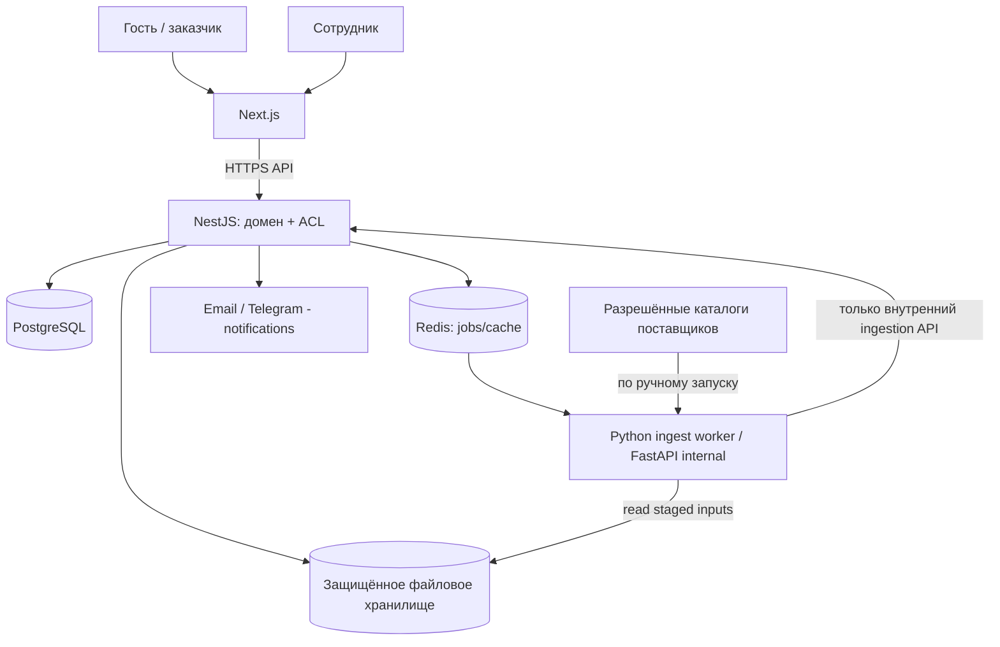

# СВОДНОЕ ТЗ R1 — B2B Graphite & Petrol

Статус: рабочая постановка для первого коммерческого релиза. Полный реестр утверждённых решений №1–108 находится в `01_DECISION_REGISTER.md`.

## Содержание

- 02_RELEASE_SCOPE.md
- 03_MASTER_TZ_R1.md
- 04_ARCHITECTURE.md
- 05_DOMAIN_MODEL.md
- 06_API_CONTRACTS.md
- 07_SECURITY_OPERATIONS.md
- 08_TESTS_AND_ACCEPTANCE.md
- 09_ROADMAP_BACKLOG.md
- 10_CODEX_ORCHESTRATION.md
- 11_DECISIONS_PENDING.md


---

<!-- Часть 1: 02_RELEASE_SCOPE.md -->

# Границы релизов и соглашения по объёму

## R1 — первый коммерческий релиз (УТВЕРЖДЁН пользователем)

**Цель:** от входящего интереса и клиентской спецификации до проверенного, рассчитанного, утверждённого коммерческого предложения и защищённой страницы для получателя.

R1 включает семь сквозных возможностей:

1. **Публичный сайт/каталог:** три равноценных направления — оборудование, изготовление электрощитов и проектирование; технический каталог с категориями, брендами и настраиваемыми атрибутами, фильтрами, документами, поиском и отображением публичной цены или «Цена по запросу»; карточки стандартных шкафов и форма индивидуального запроса.
2. **Внутренняя номенклатура:** ручное создание/редактирование, Excel/CSV-импорт, связь нескольких источников цен с одним физически идентичным артикулом; контроль каждой публикации администратором.
3. **Python-парсер:** администратор запускает вручную; источники только разрешённые/проверенные; получение цен/характеристик/ссылок; предварительный набор изменений, которые проверяются и утверждаются **по одному**, не автоматически и не массово; истекшая цена для публичного каталога — «Цена по запросу».
4. **Заявки:** анонимный запрос КП по товару/корзине запроса/услуге/типовому или индивидуальному щиту; вложения и исходные спецификации; внутренние статусы и назначение менеджера/инженера; уведомления.
5. **Импорт спецификаций:** XLSX/CSV и текстовые PDF, включая многостраничные/многосекционные; хранение оригинала и каждой исходной строки, исходной единицы/количества и группировки; структурирование, совпадения по **точной идентичности**; дубли и агрегирование с сохранением происхождения; нераспознанные позиции, ручные исправления. Функциональные аналоги **только вручную инженером**.
6. **Инженерная экспертиза и калькуляция:** вопросы заказчику, замечания, ответственный инженер с правом единолично утверждать техчасть, версия спецификации и повторная проверка технических изменений; BOM типового/индивидуального шкафа, укрупнённые нормативы труда, дополнительные услуги, стоимость приобретения, ручная логистика и настроечные правила наценки/скидки/маржи; источники закупки и предложения поставщиков в составе оценки **без оформления закупочных заказов и резерва склада**.
7. **КП:** редактируемый черновик, ручное утверждение менеджером, выбор собственного ООО/ИП, налоги/реквизиты, построчное/агрегированное/смешанное представление, секции, несколько шкафов/связанных КП; PDF, защищённая веб-страница, обратная связь «интересует»/«нужна корректировка», срок действия, неизменяемые версии, архив, запрет предварительного подтверждения просроченного КП. **Сигнал заинтересованности в R1 не создаёт клиентский заказ** — его создание добавляется в R2 по №66.

### Минимальные обеспечивающие функции R1

- Единая админка, роли и разрешения: администратор, редактор каталога, инженер, менеджер КП (настройка прав по действиям). Запрос без регистрации; внутренний вход сотрудников.
- Конфигурация нескольких **собственных** ООО/ИП с налоговыми правилами, ручной выбор продавца и неизменяемый снимок реквизитов в утверждённом КП.
- Файловая библиотека с правами/версиями, первичные системные события, разграничение служебных и внешних комментариев.
- Email/Telegram для необходимых уведомлений при наличии настроенных каналов; сайт работоспособен при недоступности канала.
- Шаблонный контент/SEO для каталога, услуг и основных технических страниц; SEO-расширения по мере развития.
- Безопасность, обработка персональных данных, резервное копирование и эксплуатация на одном российском VDS (минимальная надёжная конфигурация).

## За границей R1, но ОБЯЗАТЕЛЬНО сохраняются в целевой концепции

### R2 — следующий предлагаемый пакет, сроки/состав поэтапности ещё не утверждены

- Подтверждённый интерес к КП → черновик клиентского заказа; запуск вручную менеджером (№66).
- Корпоративные кабинеты после подтверждения организации; ролевой клиентский доступ (№17–18).
- Управление клиентскими заказами, их изменениями, товарами и частичными отгрузками (№67–69).
- Учет закупок и поставщиков на уровне заказов поставщикам (№70); количественный склад, ручные резервы, корректировки и выборочные серийные номера (№23, №71–73).
- Операции оплат и возвратов (№87, №90), предупреждения о недоплате без блокировки (№91); документы внешнего происхождения (№88–89).

### R3 — предлагаемый производственный пакет

- Производственные заказы и этапы, материалы, допвыдачи/возвраты (№15, №75, №92–96).
- Выпуск готового электрощита с номером, QC и паспортом (№41–42, №76), QR/шильдик (№77), комплект документации (№78), изменения файлов (№79), сервисные обращения (№80).
- Фактические часы, план-факт себестоимости, предупреждения по марже и допрасходы (№40, №101–103).
- Простые производственные правила без MES: №98–100, №104–108.

**Примечание:** R2/R3 — предлагаемое техническое разбиение. Пользователь утвердил только **R1 и перенос остального в последующие релизы**. Нельзя считать даты, содержание R2/R3 или порядок запуска согласованными.

## Запреты на скрытое расширение R1

- Нет оформления заказа и онлайн-оплаты, автоматических резервов, физического складского учёта или выпуска электрощита.
- Нет автоматических технических аналогов и замен; даже потенциальную замену предлагает и подтверждает инженер вручную.
- Нет автоматического парсинга по расписанию или массового утверждения изменений от парсера.
- Нет автоматической отправки заказа поставщику и интеграций 1С/ЭДО/банков/транспортных компаний.
- Нет техкарт/МES, дистанционного доступа к контроллерам, эксплуатации объектов, инструментального хозяйства.
- Нет самостоятельного задачника, тяжёлого BI, drag-and-drop CMS, сложной мультикомпанейской ERP.
- Нельзя автоматически изменять утверждённые КП при изменении цен, валют или источников товара.

## Договорённость об объёме работ агента

Каждая новая функция либо имеет явное требование R1 в `03_MASTER_TZ_R1.md`, либо отложена. Если задача затрагивает решение отложенного релиза, агент создаёт **интерфейс расширения**, не саму бизнес-операцию.

## Definition of commercially usable R1

Менеджер без ручной правки БД может пройти путь: создать/обновить каталог → вручную запустить импорт источника и поштучно принять изменения → получить гостевую заявку с файлом → восстановить исходную структуру спецификации → вручную разрешить неопределённости и дать инженеру утвердить техчасть → посчитать стоимость, логистику, налоги и порог маржи → сформировать и утвердить КП → отправить ссылку/PDF → получить интерес или запрос доработки → архивировать версию и корректно обработать истечение срока.


---

<!-- Часть 2: 03_MASTER_TZ_R1.md -->

# ОСНОВНОЕ ТЕХНИЧЕСКОЕ ЗАДАНИЕ — R1

## 0. Область применения и статус

**Продукт:** оригинальная B2B-платформа для промышленного оборудования (включая Wiren Board), проектирования/изготовления электрических щитов и инженерных услуг в РФ. Продукт не является розничным интернет-магазином и в R1 не создаёт клиентские/закупочные заказы. Основные клиенты — подрядные и электромонтажные организации.

**Цель R1:** заявки → инженерная работа → калькуляция → утверждённое КП, с управляемой номенклатурой и парсером. Подробная трассировка — `01_DECISION_REGISTER.md`. Всё, что не сформулировано здесь как R1, не должно добавляться агентом по умолчанию.

**Типы пользователя:** неавторизованный посетитель/заявитель; внутренние сотрудники (администратор, редактор каталога, менеджер, ответственный инженер); потенциальный корпоративный клиент (структура предусмотрена, кабинет отложен). Роли настраиваются разрешениями, названия ролей — стартовые шаблоны, а не хардкод.

### Обязательные сквозные нефункциональные требования

- Русскоязычный интерфейс, адаптация под десктоп/планшет/мобильные устройства; читаемость технических таблиц на десктопе и доступный вариант на мобильных.
- Серверные проверки прав во всех административных маршрутах; безопасная загрузка, выдача и хранение файлов; служебные данные не отправляются клиенту.
- Не выдавать автоматически подтверждённые клиентом обязательства: реакция на КП — **предварительный интерес**, юридически незначимая отметка.
- Формирование и просмотр утверждённых документов воспроизводимы; историю нельзя менять задним числом.
- Ошибки парсинга, частично разобранные спецификации, нераспознанные SKU и неполные исходные данные не должны блокировать всю заявку: выводить список проблем на ручную обработку.

## 1. Публичный сайт и каталог (CAT)

**CAT-01** Главная страница содержит равнозначные входы в оборудование, изготовление электрощитов и проектирование/программирование. Первый экран: инженерный акцент, поиск, загрузка спецификации, запрос КП. Навигация двухрядная, мегаменю, закреплённый поиск/КП.

**CAT-02** Каталог поддерживает бренды, иерархии категорий, категории-специфичные характеристики, единицы измерения и управляемые поля. Wiren Board — один из приоритетных брендов, но модель открыта.

**CAT-03** Из карточки товара доступны название, производитель, идентификатор производителя, модификация, фото, технические свойства, файлы/сертификаты/схемы, взаимосвязанные аксессуары/совместимое оборудование (связи задаются ответственным сотрудником), предложение цены или «Цена по запросу», кнопка заявки. Без автоматически подобранных функциональных аналогов.

**CAT-04** Отображение каталога переключается между плиткой, компактным списком и технической таблицей; фильтрация по применимым атрибутам, поиск по названию/артикулу/бренду/характеристикам, сравнение технических свойств; публичные маршруты пригодны для индексирования.

**CAT-05** Админ вручную создаёт и редактирует продукты/категории/бренды/атрибуты, загружает CSV/XLSX в промежуточный предпросмотр, утверждает импортируемые изменения до публикации. Обязательно сохранение источника/времени/изменившего сотрудника.

**CAT-06** Публичная цена видна только когда разрешена для данной товарной записи и информация действительна; если подтверждённая импортированная цена просрочена, показывать именно **«Цена по запросу»**. Истечение задаётся политикой свежести источника (конфигурация админа); нельзя тихо показывать просроченную цену.

**CAT-07** Типовые шкафы: категория шкафа, описание, типовая спецификация BOM, опции, документы и запрос модификации. Индивидуальные шкафы: динамическая форма «готовый проект / изменить типовой / ТЗ с нуля», свободные примечания и вложения. Не давать неподтверждённого автоматического конфигуратора.

**CAT-08** Контентные страницы (услуги, типовые щиты, статьи, кейсы) редактируются только через фиксированные шаблоны. Базовое SEO: уникальные URL/slugs, title/description/canonical, sitemap, robots, schema при соответствующих страницах, качественные заголовки и метаданные.

## 2. Источники поставщиков и парсер (SRC)

**SRC-01** Администратор создаёт разрешённые источники (производитель/поставщик), метод извлечения, область доступа, политику свежести цен. Необходима проверка правомерности использования источника; без обхода аутентификации и технических запретов.

**SRC-02** Парсер запускается **только явным действием администратора**. Расписание/автоматический регулярный обход запрещён в R1. Выполнение — фоновая задача с журналом статуса, длительности, числа кандидатов и ошибок.

**SRC-03** Все извлечённые значения попадают в *staging* (сырые источники + нормализованные поля + provenance), **никогда сразу в публичный каталог**.

**SRC-04** Для КАЖДОЙ изменённой записи/поля администратор отдельно выбирает принять/отклонить с видимым «старое → новое»; массовое утверждение из парсера запрещено. До решения текущая опубликованная версия сохраняется.

**SRC-05** Идентичный физический SKU от разных поставщиков определяется строго по производителю/бренду, оригинальному артикулу и модификации; связь предложений с карточкой каталога подтверждает администратор поштучно. Текстовая похожесть не является основанием автоматического связывания.

**SRC-06** Сохраняются цена приобретения, наличие/срок поставки (если присутствуют в источнике), валюта/НДС источника, дата/URL и контекст предложения. Отсутствующие значения не выдумывать. Можно вручную вносить и сравнивать предложения поставщиков.

**SRC-07** Для товара без каталогового соответствия сотрудник ведёт поиск/сравнение предложений в рамках заявки; новый SKU — только черновик и утверждение редактором. Система не рассылает автоматически запросы поставщикам.

**SRC-08** При ошибке источника логируются технические причины без секретов; фоновые сбои не нарушают доступность каталога и не публикуют частичные изменения.

## 3. Заявки и исходные документы (REQ)

**REQ-01** Публичный посетитель может отправить заявку без регистрации: контакты, организация при наличии, предмет запроса, товары/количества, сроки/место доставки при наличии, свободное описание и вложения. Политики обработки ПД и согласия — предмет обязательной юридической проверки до запуска.

**REQ-02** Заявка поступает в единую админку. Минимальная цепочка: `новая → на разборе → требует уточнения / инженерная проверка → готова к КП → КП отправлено → закрыта`; детально описать в `05_DOMAIN_MODEL.md`.

**REQ-03** Назначаем менеджера и ответственного инженера, видим сроки этапов и историю комментариев. Внутренние заметки не показывать клиенту. Email/Telegram — каналы доставки уведомлений, а не внешняя клиентская учётная система.

**REQ-04** Исходный загруженный файл хранится неизменным с хэшем, размерами, типом, авторством/каналом и записью об обработке. Результат извлечения — отдельная сущность; неправильный разбор не изменяет оригинал.

## 4. Разбор спецификаций и инженерная экспертиза (SPEC/ENG)

**SPEC-01** Поддержать Excel (в т.ч. XLSX), CSV и PDF, содержащие извлекаемый текст. Сканированные PDF и нечитаемые файлы — статус «нужен ручной разбор», а не фиктивный результат OCR. Расширение OCR — отдельное решение.

**SPEC-02** Хранить лист/страницу, секцию/подсекцию, исходную строку, исходное наименование, артикул, единицу, количество, примечание и ссылку на позицию в оригинале. Допустить незаполненные атрибуты и нецелые количества с единицей измерения, если это исходно корректно.

**SPEC-03** Определять вероятные дубли для ПРЕДЛОЖЕНИЯ объединения и итоговых количеств, но не терять отдельные строки и привязку к секциям. Любая агрегация должна быть обратимо прослеживаема.

**SPEC-04** Автоматическое сопоставление допускается только по подтверждённой идентичности товара; спорные/неполные соответствия выводятся как «требует решения». Функциональные аналоги/замены подбирает только инженер вручную с обоснованием и историей. Никаких автоматических рекомендаций похожих функциональных аналогов.

**SPEC-05** Внутренняя инженерная проверка с вопросами, замечаниями и статусом. Ответственный инженер утверждает подготовленную техническую редакцию, может совпадать с разработчиком. Записываются точная редакция, дата, пользователь. Изменение технического решения требует повторной проверки.

**SPEC-06** Спецификации и их редакции не перезаписываются: новая редакция — отдельная запись, исходные строки и связи остаются доступны для аудита.

## 5. Калькуляция и коммерческая политика (CALC)

**CALC-01** Менеджер выбирает предложения поставщиков и вручную подтверждает закупочную основу. Система может показать варианты источников/цен/сроков с учётом доступной информации и логистики, но не использует реальные складские остатки, пока нет R2.

**CALC-02** Для готового оборудования: закупочная стоимость, транспорт/упаковка, коммерческая наценка, выбранный налоговый режим, скидка, итоговая продажная цена. Для шкафа: BOM, укрупнённые трудовые нормативы, программирование/испытания, накладные, доставка, маржа. Исключить двойной учёт комплектующих/работ.

**CALC-03** Правила цены могут быть по категории, бренду, количеству, клиентскому сегменту и собственному юрлицу. Модель порога маржи; исключения подлежат предусмотренному согласованию. Формулы, определения «маржи» и «наценки» явно различать.

**CALC-04** Логистика вводится вручную, можно выбрать самовывоз, включение доставки в цену позиции или отдельную строку; налоги/реквизиты и итоговая сумма пересчитываются с учётом выбранного юрлица. Не задавать единственную фиксированную ставку НДС в коде.

**CALC-05** Сохранять снимок цены, источников, затрат, коэффициентов, курсов (если вводятся) и расчётных правил при утверждении КП. Последующие импорты не меняют утверждённую цену.

## 6. Коммерческие предложения (QUOTE)

**QUOTE-01** КП создаётся из рассмотренной заявки и утверждённой инженером технической спецификации. Система формирует черновик, менеджер редактирует и утверждает. Не отправлять автоматически без его подтверждения.

**QUOTE-02** Поддержать разделы по отдельным шкафам/товарам/услугам, общую сводку, построчный/укрупнённый/смешанный вид, несколько связанных КП. Каждая позиция связана с исходной строкой спецификации, но внутренние закупочные цены, себестоимость и маржа не видны клиенту.

**QUOTE-03** Несколько собственных ООО/ИП с реквизитами, банковскими счетами и налоговыми настройками. Менеджер выбирает продавца вручную; поля юрлица и условия продажи копируются в снимок утверждённой редакции КП.

**QUOTE-04** Генерировать PDF и защищённую интерактивную веб-страницу для получателя. Клиент может посмотреть/скачать, отметить **предварительный интерес** и запросить изменение; это не договор и не юридический акцепт. В R1 реакция фиксируется как отдельное событие; черновик заказа появится только в R2.

**QUOTE-05** Срок действия обязателен и показан получателю. На истёкшем КП предварительное подтверждение недоступно. Для изменения цены/состава/срока создаётся НОВАЯ редакция, заново проверяется исходная стоимость и утверждается менеджером. Старую PDF/снимок/условия нельзя заменить задним числом.

**QUOTE-06** Клиентский токен доступа случайный и устойчивый к подбору; хранится хэш, допускается отзыв доступа. Любые внутренние/закупочные поля исключить из клиентских API и PDF серверным DTO.

## 7. Администрирование, уведомления, файлы и SEO (ADM)

**ADM-01** Одна административная панель; меню и действия показываются по серверным разрешениям. Сотрудник может иметь несколько ролей. Журнал ключевых изменений содержит дату, автора, объект и действие.

**ADM-02** Менеджер/инженер видят задачи как статусы и этапы заявок/КП, отдельного таск-трекера нет. Напоминания/SLA по настроенным этапам; email/Telegram поддерживаются как каналы, не должны блокировать основную операцию при временном сбое.

**ADM-03** Файловая библиотека: объектное связывание, версия, метаданные, права и история; скачивание через проверяемую авторизацию или строго ограниченную внешнюю ссылку. Приложения в PDF КП — только явно разрешённые.

**ADM-04** Поля контента редактируются по фиксированным шаблонам, SEO-настройки доступны контент-редактору. Динамические данные продукта корректно отображаются на публичных страницах, индексирование не раскрывает внутренние данные.

## 8. Бизнес-критерии завершения R1

- Пользователь проходит семь сквозных возможностей, перечисленных в `02_RELEASE_SCOPE.md`, без прямого редактирования БД и без единственного «магического» локального сценария.
- Есть демонстрационные данные ≥2 брендов, ≥3 категорий товаров и ≥2 источников поставщиков; импорт подтверждается вручную; можно получить КП с несколькими секциями.
- В тестах подтверждаются запреты: парсер не публикует сам; просроченная цена не показывается; неподтверждённые аналоги не подставляются; менеджер вручную утверждает КП; изменённая себестоимость не меняет утверждённое КП; истёкшее КП не принимает интерес; клиент не видит закупочную цену.
- Настроен и испытан restore из резервной копии; ограничения размера/типа файлов и журнал ошибок; интеграционный и E2E набор зелёный.

## 9. Неприсвоенные решения, не блокирующие начало разработки

Конкретные банковские/почтовые провайдеры, хостнеймы, исходные коммерческие тарифы, юридические шаблоны документов и разрешённые источники парсинга назначаются через конфигурацию/контент. Не зашивать в код предположения о фактических реквизитах, ставках налогов, закупочной стоимости, наличии товара и договорных условиях.


---

<!-- Часть 3: 04_ARCHITECTURE.md -->

# Архитектура R1 — модульный монолит + изолированный Python ingestion

## 1. Главные архитектурные решения

- **Next.js**: публичный SSR/SEO-сайт, формы, защищённый просмотр КП, единая админка; UI не решает вопросы разрешений и расчёта авторитетных сумм.
- **NestJS (модульный монолит)**: единственный владелец доменных команд и транзакций, RBAC, версий, цен, КП, клиентского API.
- **Python/FastAPI + фоновые процессы**: контролируемое извлечение из Excel/CSV/PDF и разрешённых сайтов поставщиков; без права незаметной публикации данных.
- **PostgreSQL**: единственный транзакционный источник истины; миграциями распоряжается владелец схемы.
- **Redis**: очередь заданий, краткоживущий кэш/идемпотентность, не долговременное хранилище бизнеса.
- **Файлы**: локальная конфигурируемая защищённая директория тома сервера в R1 с единым `StoragePort`, чтобы позже заменить реализацию; обязательный внешний бэкап и контроль прав. Оригиналы и утверждённые снимки считаются неизменяемыми.
- **Deploy**: одна российская VDS/VPS, контейнеры Docker, HTTPS, изоляция внутреннего ingestion от интернета; внешние резервные копии и минимальный мониторинг. Не навязывать Kubernetes/микросервисы/managed-cloud.

Рекомендуется монорепозиторий; конкретные версии библиотек и пакетных менеджеров фиксируются первым архитектурным PR, а не предполагаются утверждёнными пользователем.

```text
b2b-platform/
├─ AGENTS.md
├─ apps/
│  ├─ web/                     # Next.js, публичные страницы + admin + quote portal
│  └─ api/                     # NestJS modules, Prisma/TypeORM (выбрать в ADR)
├─ services/
│  └─ ingestion/               # Python/FastAPI, parsers, spec extractors
├─ packages/
│  ├─ api-client/              # автогенерация из OpenAPI, не вручную
│  ├─ design-tokens/           # #172838, #177A83 и др.
│  └─ shared-config/           # только конфигурационные типы, без бизнес-логики
├─ infra/
│  ├─ compose/
│  └─ scripts/
├─ docs/
│  ├─ architecture/
│  ├─ contracts/
│  └─ plans/
└─ tests/
   ├─ fixtures/
   └─ e2e/
```

## 2. Logical diagram



У Python-компонента нет полномочия выставить `published=true` или `quote.approved=true`. Его выход — **кандидаты / сырой разбор / метаданные**. Доменные решения принимает NestJS после проверки прав сотрудника.

## 3. NestJS bounded contexts

| Модуль | Владеет | Не владеет |
|---|---|---|
| Identity/RBAC | учётные записи сотрудников, сессии, роли, разрешения, подтверждение org scopes | клиентские корпоративные кабинеты R2 |
| Organizations | собственные ООО/ИП, банковские реквизиты, налоговые настройки | раздельная собственность склада |
| Catalog | бренд, категория, атрибут, товар, фотографии и опубликованная цена | парсинг веб-сайта, резервы склада |
| SupplierOffers | поставщик, ручные предложения, связь предложений с SKU, происхождение цен | размещение закупочного заказа |
| Ingestion | источники, ручной запуск, журнал, кандидаты изменений, решения админа | самостоятельная публикация |
| Requests | заявки, состав запроса, контакты, источники, этапы/ответственные | клиентский заказ |
| Specifications | исходный документ, строки, разделы, результаты сопоставления, ревизии | выбор функционального аналога автоматически |
| Engineering | проверка, замечания, запросы уточнений, утверждённая редакция | независимый обязательный проверяющий |
| Pricing | калькуляции, коммерческие политики, стоимости, маржа, ручная логистика | бухгалтерский учёт |
| Quotations | КП, строки/секции, утверждение, иммутабельные редакции, PDF, защищённые ссылки, отклики | автоматический запуск заказа |
| Documents | файлы, версии, связи с объектами, безопасные выдачи | файловые пути из свободного input |
| Content/SEO | фиксированные шаблоны страниц, SEO | drag-and-drop CMS |
| Notifications | задания email/Telegram, доставка, повторные попытки | основной статус бизнес-объекта |
| Audit | события разрешённых бизнес-изменений | телеметрия производственного оборудования |

Каждый модуль использует свои доменные сервисы и репозитории; прямое изменение таблиц «чужого» модуля запрещено, кроме согласованных транзакционных интерфейсов. Внешний API стабилен и версионируется.

## 4. Точки расширения R2+ (НЕ реализовывать в R1)

- `QuoteInterestRecorded` → позднее `ClientOrderDraftCreated`; в R1 только сохранять интерес к КП.
- `CatalogItemId` будет стабильным FK для складских товаров, закупок, резервов, комплектаций.
- `OrganizationSellerId` используется уже в R1, поэтому будущие заказы наследуют точно того продавца, который указан в КП.
- `DocumentVersionId` закрепляется за редакциями КП; позднее — за производственными паспортами.
- `SpecificationRevisionId` пригоден и для калькуляции, и для будущего производственного BOM.
- `RequestId` → `QuoteId` → future `OrderId`, не моделировать весь order lifecycle до R2.
- Доменные события создаются с `event_id`, `occurred_at`, `aggregate_id`, `schema_version`; потребители будущих релизов могут на них подписаться без миграции всей модели.

## 5. API, события, контракты

- REST + JSON, документировать **OpenAPI** от NestJS; типизированный клиент web генерируется из OpenAPI при CI.
- Все команды с побочными эффектами авторизуются сервером, валидируются, записывают audit event. Для повторяемых POST, внешних обратных вызовов и фоновой записи поддержать `Idempotency-Key` либо эквивалент.
- `ingestion` принимает от API jobId с типом `supplier_catalog` или `customer_spec`. Фоновая задача сохраняет результат через internal service contract, не напрямую публикует каталог.
- Фоновые процессы имеют retry/backoff и dead-letter/error status, с идемпотентной обработкой одного jobId.
- Номер КП — отдельный человекочитаемый идентификатор; внутренние UUID не раскрывают последовательность клиентских заказов.
- Все даты в БД UTC плюс timezone для отображения/источника; деньги — decimal с явной валютой и налоговой базой; никакого JS float для итогов.

## 6. ADR, которые нужно зафиксировать перед кодом

1. ORM/миграции: Prisma или TypeORM; **единственный** владелец миграций — ведущий backend-агент.
2. Стратегия token/session auth для внутренних пользователей и токенов внешнего просмотра КП.
3. StoragePort: имена томов, безопасные имена объектов и стратегия резервного копирования.
4. CSV/XLSX/PDF parsing contracts: размер, encoding, правила разметки строк; fixture-набор.
5. Инструмент для очереди Redis, таймауты/ретраи/идемпотентность.
6. Форматы PDF КП, политика ревизий и электронного архива.

**Правило:** ADR — разрешение технического выбора реализации, а не повод изменять утверждённую бизнес-функциональность.


---

<!-- Часть 4: 05_DOMAIN_MODEL.md -->

# Доменная модель, снимки и жизненные циклы R1

## 1. Сущности (предварительная логическая схема; конкретные таблицы в migrations/ADR)

### Организации и доступ

- `StaffUser(id, email, password_hash, state, ...)` — внутренний пользователь.
- `Role`, `Permission`, `UserRole`, `RolePermission`, `StaffMembership` — связь разрешений и подразделения/собственного юрлица там, где требуется.
- `SellerLegalEntity(id, name, kind[ООО|ИП], tax_config, bank_accounts, requisites, active)` — **собственные** продавцы; смена справочника не переписывает редакцию КП.
- `BusinessCounterparty(id, organization_name?, inn?, contacts, ...)` — заявители/компании-покупатели; подтверждение корпоративного кабинета — только R2.

### Каталог и коммерческие источники

- `Brand`, `Category(parent_id)`, `AttributeDefinition(category_id, type, unit, filterable)`, `CatalogProduct(brand_id, manufacturer, manufacturer_part_number, modification, slug, publication_state, ...)`.
- `ProductAttributeValue(product_id, attribute_definition_id, value)`, `ProductDocumentVersion`, `ProductMedia`, `ProductRelation` (аксессуары/совместимость, **ручные** связи).
- `Supplier`, `SupplierOffer(supplier_id, product_id?, original_sku, currency, purchase_cost, availability_text?, lead_time?, observed_at, expires_at?, source_url?, state)`.
- `SupplierSource(id, authorized_scope, origin_url, parse_adapter, freshness_policy, enabled)`.
- `IngestionRun(id, requested_by, requested_at, status, metrics, logs_pointer)`; `IngestionCandidate(id, run_id, field_path, before, proposed, origin, decision, reviewer, decided_at)`.
- `ProductMatchProposal(id, offer_id, product_id, evidence, status)` — утвердить поштучно, не автосклеивать.

### Заявки и инженерные спецификации

- `Inquiry(id, counterparty_id?, contact_snapshot, channel, kind, status, assigned_manager_id, due_at, created_at)`.
- `InquiryLine(id, inquiry_id, raw_title, sku?, qty, unit, notes?, catalog_product_id?)`.
- `SourceDocument(id, object_storage_key, checksum, mime, original_filename, uploader, uploaded_at, locked=true)`.
- `SpecImportRun(id, source_document_id, parser_version, status, issues)`.
- `SpecificationRevision(id, inquiry_id, number, origin_revision_id?, status, created_by, approved_by?, approved_at?)`.
- `SpecificationSection(id, revision_id, parent_id?, title, sequence)`; `SpecificationLine(id, section_id, raw_row_ref, raw_title, raw_part_no?, qty, unit, resolved_product_id?, resolution, notes, sequence)`.
- `SpecLineOrigin(line_id, source_document_id, sheet_page, row_coord, raw_values)`; `SpecLineAggregation(aggregated_line_id, source_line_id, qty_portion)`.
- `EngineeringReview(id, specification_revision_id, reviewer_id, status, remarks, signed_at)`; `EngineeringChangeHistory` или общий audit с историей ревизий.

### Калькуляции/КП/файлы

- `Costing(id, inquiry_id, spec_revision_id, seller_id, status, pricing_rule_snapshot, calculation_version)`; `CostLine(id, section_id, source_line_refs, purchase_offer_id?, material_cost, labor_cost, overhead_cost, logistics_cost, selling_price, tax_basis, currency)`.
- `Quotation(id, inquiry_id, seller_id, current_draft_id?, status, created_by)`; `QuotationRevision(id, quote_id, rev_no, source_costing_id, approved_by?, approved_at?, expires_at, immutable_payload_hash, seller_requisites_snapshot, tax_snapshot, pricing_snapshot, pdf_document_version_id?, public_access_state)`.
- `QuotationSection`, `QuotationLine`, `QuoteFeedback(id, revision_id, kind[interest|revision_requested], message?, created_at, actor_context)`.
- `QuoteAccessToken(id, revision_id, token_hash, revoked_at?, expires_at, permitted_actions)`.
- `FileObject(id, storage_key, checksum, mime, size, scan_state, created_by)`; `FileVersion(id, file_id, version, file_object_id, ...)`; `FileLink(file_version_id, entity_type, entity_id, visibility)`.
- `AuditEvent(id, actor_id, action, entity_type, entity_id, changed_fields, timestamp, correlation_id)`.

## 2. Инварианты

1. `CatalogProduct` может быть публичным только после положительного решения уполномоченного сотрудника; кандидаты парсера не могут напрямую менять опубликованное поле.
2. Уверенное сопоставление товара предполагает идентичные manufacturer + original_part_number + modification и утверждённую админом связь между предложением поставщика и продуктом. «Похожий функциональный аналог» — **никогда автоматический выбор**.
3. Новая ревизия спецификации не перезаписывает старые исходные строки. Техническая редакция, существенно изменённая после утверждения, должна снова пройти `EngineeringReview`.
4. `QuotationRevision APPROVED` immutable: никакой UPDATE цен/строк/налогов/продавца/сроков, только новые ревизии. При повторной публикации старый PDF сохраняется.
5. Новые цены поставщика или обновления каталога **не пересчитывают** утверждённую редакцию КП.
6. Реакция `interest` доступна только действительной, неотозванной, неистёкшей редакции; никогда не создаёт заказ в R1.
7. Файлы с внутренними ценами/комментариями исключены из публичных DTO и PDF; прямой URL файлов не обходит ACL.
8. «Готовая работа» инженера и «утверждённая коммерческая цена» — разные права/действия.
9. Для расчёта денег использовать decimal и валюту; ставка и метод применения налога — **из конфигурации продавца/КП**, без хардкода.
10. Историческое происхождение данных позволяет реконструировать результат КП без внешнего сайта/старой текущей цены.

## 3. Состояния и переходы

### Catalog / source

```text
Product: DRAFT -> PENDING_REVIEW -> PUBLISHED -> ARCHIVED
IngestionRun: CREATED -> RUNNING -> COMPLETED | PARTIAL_FAILURE | FAILED
Candidate: PENDING -> APPROVED | REJECTED
MatchProposal: PENDING -> APPROVED | REJECTED
```

Важно: `Candidate APPROVED` не всегда равно `Product PUBLISHED`: окончательная публикация зависит от других обязательных атрибутов товара и роли.

### Inquiry / spec / engineer

```text
Inquiry: NEW -> TRIAGE -> NEEDS_CLARIFICATION -> ENGINEERING_REVIEW
                                |                        |
                                +------------------------+
          -> READY_FOR_QUOTE -> QUOTE_SENT -> CLOSED
SpecificationRevision: DRAFT -> IN_REVIEW -> APPROVED | RETURNED
EngineeringReview: OPEN -> NEEDS_CHANGES | APPROVED
```

Не привязывать права к текстовым статусам на клиенте; переходы проверяются сервером.

### Quotation

```text
Quote DRAFT -> PENDING_MANAGER_APPROVAL -> APPROVED -> SENT
                                             |             |
                                             +--> EXPIRED   +--> EXPIRED
Rejected approval -> DRAFT; changes after approval -> NEW REVISION (DRAFT)
Feedback on active approved revision: INTEREST / REVISION_REQUESTED
Feedback after expires_at or token revoke: NOT ACCEPTED
```

При новой редакции возможно сохранение старой как исторической; детали хранения `current_revision_id` определить в миграции. Уточнение различия `APPROVED` и `SENT`: утверждение разрешает публикацию, отправка — отдельное событие доставки.

## 4. Конфиденциальность и изоляция

- `SellerLegalEntity` принадлежит продавцу (наш бизнес); `BusinessCounterparty` представляет клиента. Не смешивать эти идентификаторы.
- В R1 публичная заявка может быть без аккаунта. Нельзя использовать только сообщённый ИНН как доказательство права читать документы компании.
- Служебные данные (закупочная стоимость, маржа, внутренние комментарии, происхождение парсинга, поставщики) существуют в закрытых API; клиентский просмотр КП строится исключительно из `PublicQuotationDTO`.
- Расширение для R2: организационное членство клиентов, роли внутри кабинета, доступ к заказам и файлам после подтверждения принадлежности к организации.

## 5. Вопросы для миграционной модели

- Единицы измерения: отдельный справочник и ограничение количества (целые/десятичные) для конкретного SKU.
- Исторические связи: на котировках хранить как стабильный SKU FK, так и snapshots названия, артикула, количества, цены и налогов.
- Точность `Decimal`, округление строк/разделов/итога и версии ценовых правил — покрыть золотыми тестами.
- Возврат импортов и исправление связи с поставщиком — через обратимые процедуры/audit, не прямой SQL в бизнес-процессе.


---

<!-- Часть 5: 06_API_CONTRACTS.md -->

# Эскиз API и событий R1 — для последующей фиксации OpenAPI

**Статус:** проектная поверхность. Ведущий агент должен зафиксировать DTO/HTTP-коды/permission matrix в OpenAPI **до параллельной реализации frontend и backend**. Ниже не означает, что API уже существует.

## 1. Публичные API

| Метод | Маршрут | Действие |
|---|---|---|
| GET | `/v1/public/catalog/categories` | дерево публичных категорий |
| GET | `/v1/public/catalog/products` | фильтры, поиск, пагинация, режим отображения на фронтенде |
| GET | `/v1/public/catalog/products/{slug}` | свойства, медиа, допустимая цена или «По запросу», документы |
| GET | `/v1/public/content/{slug}` | шаблонные страницы и SEO |
| POST | `/v1/public/inquiries` | анонимная заявка, rate-limit/anti-spam |
| POST | `/v1/public/inquiries/{id}/attachments` | ограниченная загрузка после привязки к защищённому upload-intent |
| GET | `/v1/public/quotes/{accessToken}` | минимальный клиентский DTO утверждённой версии |
| POST | `/v1/public/quotes/{accessToken}/feedback` | `interest` или `revision_requested` только на действительном КП |
| GET | `/v1/public/quotes/{accessToken}/pdf` | авторизованная по токену выдача именно этой редакции PDF |

Маршрут с токеном может не быть лучшим вариантом логирования; на ADR выбрать безопасную схему, минимизирующую попадание секрета в аналитические логи и Referer. Без идентификатора `accessToken` нельзя получить приватные данные.

## 2. Внутренние API

| Контекст | Пример команд |
|---|---|
| staff/auth | `POST /v1/staff/auth/login`, `POST /logout`, `GET /me` |
| catalog | `POST /v1/staff/catalog/products`, `PATCH /{id}`, `POST /{id}/submit`, `POST /{id}/publish` |
| catalog imports | `POST /v1/staff/catalog/imports`, `GET /{id}/preview`, `POST /{id}/apply` (с ручным подтверждением) |
| suppliers | `GET/POST /v1/staff/suppliers`, `GET/POST /offers`, `POST /match-proposals/{id}/decision` |
| parser | `POST /v1/staff/ingestion-runs` (ручной admin action), `GET /{id}`, `GET /{id}/candidates`, `POST /candidates/{id}/decision` (одна запись) |
| inquiries | `GET /v1/staff/inquiries`, `GET /{id}`, `PATCH /{id}/assignee`, `POST /{id}/comments`, `POST /{id}/transition` |
| spec | `POST /v1/staff/inquiries/{id}/spec-imports`, `GET /{runId}`, `GET /spec-revisions/{id}/sections`, `PATCH /spec-lines/{id}/resolution`, `POST /spec-revisions/{id}/submit` |
| engineer | `POST /v1/staff/spec-revisions/{id}/reviews`, `POST /reviews/{id}/approve`, `POST /reviews/{id}/return` |
| pricing | `POST /v1/staff/costings`, `PATCH /{id}/lines`, `POST /{id}/calculate`, `GET /{id}/breakdown` |
| quotations | `POST /v1/staff/quotes`, `PATCH /{id}/draft`, `POST /{id}/submit`, `POST /{id}/approve`, `POST /{id}/publish`, `POST /{id}/new-revision`, `POST /{id}/revoke-access` |
| documents | `POST /v1/staff/files/upload-intent`, `POST /files/{id}/versions`, `GET /files/{id}/download` |
| admin/org | `GET/POST/PATCH /v1/staff/sellers`, `GET/POST /v1/staff/pricing-rules`, `GET /v1/staff/audit` |

Это группы, а не финальный перечень CRUD. Непроверенные «generic admin PATCH» должны быть запрещены, если поле принадлежит утверждённой ревизии.

## 3. Стандарты ответов

```json
{
  "data": { "id": "UUID", "status": "DRAFT" },
  "meta": { "requestId": "opaque-id" }
}
```

Ошибки: стабильно кодируемые `code`, `message`, `fields?`, `requestId`. Примеры кодов: `FORBIDDEN`, `FILE_REJECTED`, `SOURCE_NOT_ALLOWED`, `INGESTION_NOT_REVIEWED`, `ENGINEERING_APPROVAL_REQUIRED`, `QUOTE_REVISION_IMMUTABLE`, `QUOTE_EXPIRED`, `MARGIN_EXCEPTION_APPROVAL_REQUIRED`.

## 4. События домена

- `IngestionRunRequested`, `IngestionCandidateStored`, `IngestionCandidateReviewed`.
- `InquiryCreated`, `SpecificationImported`, `SpecificationRevisionApproved`, `EngineeringRevisionReturned`.
- `CostingCalculated`, `MarginExceptionRequested`, `QuotationRevisionApproved`, `QuotationPublished`, `QuotationExpired`, `QuotationFeedbackReceived`.
- `DocumentVersionAttached`.

События — **внутренний** механизм модульного приложения, не публичная шина обязательных микросервисов. Производимые события должны быть идемпотентны и по возможности записываться транзакционно (outbox при необходимости, если без него теряются сообщения).

## 5. Контракт Python ingestion

- Внешний сайт поставщика доступен только при ручном запуске администратора через доменный API.
- Python получает `job_id`, список разрешённых хостов/адаптеров, policy и указание staging-хранилища.
- Результат: `raw_source_blob_ref`, `normalized_candidates[]`, `extraction_warnings[]`, `source_timestamp`, `adapter_version`, `job_id`.
- Сервис получает исходный `SourceDocument` для разбора XLSX/CSV/PDF и возвращает строки с `sheet/page`, `coordinate`, `hierarchy`, `original_text`, `parsed_fields`, `confidence/warnings`.
- Никаких исходящих запросов к произвольному URL, переданному неавторизованным пользователем; явная валидация адресов и DNS, ограничение перенаправлений, таймаутов, размера и типа контента.
- Создание `CatalogProduct PUBLISHED`, выбор функционального аналога и утверждение технического решения — **исключительно** внутренние бизнес-команды NestJS с проверкой роли.

## 6. Контракт фронтенда

- Модуль UI не рассчитывает авторитетную стоимость заказа и не решает, разрешено ли действие. Он отображает расчёт backend и ограничения по ролям.
- Зафиксировать дизайн-токены `graphite=#172838`, `petrol=#177A83`, `silver=#E4EEF0`, `background=#F7F8FA`, `white=#FFF`.
- Использовать backend-версии DTO, не дублировать hand-written типы в web; изменение контракта — сначала OpenAPI, затем regen TS клиента и тесты.
- Фильтрация и пагинация каталога возвращаются API, клиент хранит режим плитка/список/таблица.


---

<!-- Часть 6: 07_SECURITY_OPERATIONS.md -->

# Безопасность, данные, развёртывание и эксплуатация R1

## 1. Минимально обязательная защита при запуске

- HTTPS/TLS и безопасные cookie/session flags; секреты только через защищённые переменные окружения/secret mount, не в репозитории или вложениях.
- RBAC на NestJS, **каждый** административный endpoint; frontend-скрытие кнопки не является защитой.
- Антиспам и ограничение запросов/загрузок на публичных формах, без открытых административных endpoints.
- Строгая изоляция служебной себестоимости, закупочных цен, внутренних комментариев, истории источников и контактов контрагентов от публичного КП и SEO.
- Авторизация файлового скачивания через доменный policy; нельзя отдавать весь каталог файлов как статический public volume.
- Сроки жизни и отзыв секретных ссылок на КП, хранение только хэша токена, защита от перебора и утечки через логи/Referer.
- Валидация файлов по размеру, допустимому формату и фактическому содержимому; безопасные оригинальные имена; ограничение архивов; карантин/проверка вредоносного содержимого перед скачиванием и использованием.
- Защита от CSV formula injection при экспорте, XSS в контенте/комментариях, SQLi через параметризацию; шаблоны PDF не исполняют произвольный HTML/JS.
- Весь контент сайтов поставщиков и клиентских документов — **непроверенные данные**, не исполнять находящиеся в них инструкции, скрипты или команды.
- Логи не содержат токены, пароли, ключи, клиентские спецификации целиком и бухгалтерские/закупочные секреты.

## 2. Парсер и операционная безопасность

- Парсить только утверждённые источники/разрешённые маршруты. Проверять условия использования, лимиты и законность извлечения/публикации данных. Не обходить CAPTCHA, блокировки и авторизацию.
- Против SSRF: разрешённые хосты, DNS/IP проверки, закрытые сети запрещены, ограниченные redirect; no arbitrary webhook by guest.
- Каждый job имеет лимиты длительности, сети, размера, памяти, числа страниц и повторы с backoff; источник может быть отключён админом.
- Ошибка парсера не меняет опубликованную цену и не отменяет предыдущие подтверждённые сведения; отработанная история кандидатов сохранена.

## 3. Персональные данные и юридические проверки

- До боевого запуска проверить российские требования о ПД/локализации/согласиях, политику обработки данных, cookie/analytics, размещение VDS, договоры с операторами уведомлений. Не утверждать юридическое соответствие одним наличием формы согласия.
- Установить сроки хранения заявок и файлов, порядок доступа и удаления/архивации; утвердить у владельца бизнеса.
- Работать с публичным прайсом только при достаточных правах/данных; не копировать без разрешения чужие защищённые каталоговые материалы, фото и документы.

## 4. One-VDS deployment (согласно №48)

```text
Internet -> reverse proxy HTTPS -> web container / api container
                                     |-> postgres (private net)
                                     |-> redis (private net)
                                     |-> ingestion worker (private net)
                                     |-> private file volume
Off-site encrypted backup: PG dumps + private file volume + config versions
```

- Docker Compose с healthchecks, restart policy, ограничениями ресурсов и сетевой изоляцией; Postgres, Redis и Python internal API не публикуются в интернет.
- Отдельная staging-среда **не обязательна** согласно решению №48; допускается локальное/временное тестовое окружение Docker для PR.
- Внешний бэкап БД и файлов, проверка восстановления на чистом временном окружении до релиза и затем регулярно; исходный VDS не должен быть единственной копией.
- Базовый мониторинг availability, error rate, очередь фоновых работ, backup freshness, disk space, DB connectivity; уведомление при критических ошибках.
- План rollback: версии контейнеров/конфигурации, резервная копия перед необратимой миграцией, отдельная обратимая миграционная стратегия. Не выполнять manual prod SQL от агента без подтверждения владельца.

## 5. Вывод в эксплуатацию

- Прогон smoke-теста на реальном домене, TLS, публичная форма, вход админа, разрешённый парсер в ручном режиме, загрузка спецификации, инженерное утверждение, PDF/ссылка КП, просроченное КП.
- Проверка отсутствия тестовых секретов и демоконтента в проде, отсутствие публичных DB/Redis портов, права файлов.
- Документировать процедуру восстановления, ключи окружения (без их значений), ответственного за VDS и политику бэкапов.
- Критические дефекты безопасности, утечки внутренней цены, обход согласований, потеря ревизии КП — блокируют релиз независимо от выполнения UI.


---

<!-- Часть 7: 08_TESTS_AND_ACCEPTANCE.md -->

# R1 — тестовая стратегия и приёмочные сценарии

## Quality gate для каждого PR

- Сборка, форматирование, линтинг и строгая типизация затронутых TS и Python пакетов.
- Юнит-тесты бизнес-правил, контрактные тесты OpenAPI, интеграционные проверки PostgreSQL и очередей Redis.
- Проверка миграций на пустой БД и на заполненной тестовыми данными; запрет silent data loss.
- Для UI — E2E на минимум Chromium desktop и mobile viewport; accessibility smoke для главных форм и таблиц.
- Security: permission-denied сценарии на API, безопасность публичных PDF/файлов, проверка неопубликованных каталоговых данных.
- Тесты должны использовать fixtures и локальные mock-сайты поставщиков; CI не зависит от живого внешнего сайта или Telegram.
- Документы и примеры конфигураций обновляются вместе с кодом; PR без тестов на новое бизнес-правило не принимается.

## Обязательные end-to-end кейсы

| ID | Сценарий и проверяемый результат | Связанные решения |
|---|---|---|
| E2E-01 | Гость открывает сайт, находит оборудование через фильтры и отправляет КП без аккаунта. | 1,7,24,30–33 |
| E2E-02 | У товара с устаревшей ценой отображается «Цена по запросу», даже если численное значение осталось в базе. | 2,58 |
| E2E-03 | Редактор импортирует CSV/XLSX товаров и видит предпросмотр; неутверждённые изменения не показываются гостю. | 6,25 |
| E2E-04 | Администратор вручную запускает парсер; в каталоге нет изменений, пока каждую предложенную правку не одобрили отдельно. Нет кнопки «одобрить все». | 45,56,58 |
| E2E-05 | Система не связывает предложения с двумя визуально похожими товарами без идентичного SKU/модификации и ручного решения админа. | 57 |
| E2E-06 | Попытка запустить парсер без роли администратора отклонена; фоновых расписаний нет. | 49,58 |
| E2E-07 | Импорт многостраничной XLSX сохраняет разделы, номера строк, количества и исходный файл; агрегирование дубликатов обратимо. | 27,62 |
| E2E-08 | Нераспознанный или неуверенный артикул остаётся открытой задачей для ручного сопоставления и не подменяется функциональным аналогом. | 27,61,62 |
| E2E-09 | Инженер вручную обосновывает замену и утверждает техредакцию; изменение требует повторной проверки и сохраняет старую версию. | 36,37,61,97 |
| E2E-10 | Состав шкафа/BOM, труд и логистика рассчитаны корректно; нет двойного счёта компонентов; маржа сравнивается с порогом. | 21,34,38,39,86 |
| E2E-11 | Менеджер формирует смешанное многосекционное КП с одним шкафом, товарами и услугами; клиент не видит закупочных цен. | 8,9,63 |
| E2E-12 | Выбор второго ООО/ИП меняет реквизиты/налоги в ЧЕРНОВИКЕ; историческая утверждённая версия первого продавца не изменяется. | 10,65,85 |
| E2E-13 | Только уполномоченный менеджер утверждает КП; до утверждения невозможно получить клиентскую ссылку/действующий PDF. | 8,16,64 |
| E2E-14 | Изменившаяся цена поставщика не меняет строку или PDF утверждённой версии КП. Новая версия проходит ручной пересчёт/повторное утверждение. | 21,56,65 |
| E2E-15 | По защищённой странице клиент скачивает только разрешённый PDF и оставляет предварительный интерес; заказы в R1 НЕ создаются. | 64,66 |
| E2E-16 | По истёкшему или отозванному КП нельзя подтвердить интерес; архивная редакция остаётся доступна сотруднику. | 65 |
| E2E-17 | Гость пытается получить `/staff/*`, скачать внутренние вложения и угадать ссылку КП: нет доступа. | 16,18,49,55 |
| E2E-18 | Уведомление email/Telegram временно недоступно: бизнес-заявка сохранена, повтор доставки задокументирован, дублей КП нет. | 19,20,45 |
| E2E-19 | Невалидный XLSX, неизвестная кодировка CSV или PDF-скан без извлекаемого текста приводит к видимой проблеме, а не к выдуманной BOM. | 27,62 |
| E2E-20 | Запрет SSRF: парсер не обращается к внутренним/локальным адресам или произвольным хостам и не выполняет команды из сайтов/файлов. | 45,49 |

## Test pyramid и фикстуры

- **Unit:** расчёт НДС по настройке юридического лица, margin-vs-markup, разнотипные единицы измерения, цена «по запросу», неизменность approved revision, несанкционированный переход состояния.
- **Integration:** Postgres migrations, RBAC, запись/чтение версий файлов, staging import, связка CSV/XLSX/PDF extractor + audit, транзакционная запись утверждения.
- **Contract:** `catalog / inquiry / spec / quote / public quote portal`, default deny, генерация TS клиента из OpenAPI.
- **E2E:** сценарии E2E-01…20 на фиксированных данных. Реальные закрытые сайты не используются как тестовый oracle.
- **Security:** token entropy/hashing, safe cookies, rate limits, небезопасные CSV/HTML/PDF, ACL файлов, MIME mismatch, SSRF, поиск утечек PII/секретов в логах.

## Приёмка владельцем проекта

На каждый законченный вертикальный срез агент показывает: (1) путь пользователя, (2) скриншоты/UI, (3) PR/diff, (4) список тестов и команд с фактическим результатом, (5) обнаруженные ограничения, (6) ссылки на пункты ТЗ и решения. Результат «готово» без пройденных проверок не считается приёмкой.

## Контроль качества перед публичным запуском

- Фактически выполненное тестовое восстановление резервной копии БД и прикреплённых файлов.
- Проход полного бизнес-сценария владельцем проекта на данных, максимально близких к реальным заявкам.
- Контроль, что в клиентском PDF/DTO отсутствуют маржа, внутренние закупочные цены и служебные заметки.
- Проверка юрисдикционных требований обработки персональных данных и разрешений на использование данных каталогов.
- Метрики производительности и допустимые размеры файлов фиксируются по результатам нагрузочной пробы; числовые SLA ещё не утверждены пользователем.


---

<!-- Часть 8: 09_ROADMAP_BACKLOG.md -->

# План исполнения R1 через Codex

## Последовательность релизного потока

```text
M0: требования/контракты
  ↓
M1: скелет, auth, permissions, DB, design tokens, CI
  ↓
M2: каталог + сайт + админка + ручной импорт
  ↓
M3: ручной parser + staging + индивидуальное утверждение
  ↓
M4: анонимные заявки + Excel/CSV/PDF import + инженерные редакции
  ↓
M5: калькуляция, многосекционные КП, утверждение, PDF/portal
  ↓
M6: сквозные сценарии, безопасность, восстановление, коммерческий запуск
```

Это **порядок зависимостей, не календарный срок**. Дату и объём каждой итерации оценивать после первых реальных PR.

## Backlog (функционально ограниченные задания)

| Task | Приоритет | Зависит от | Результат и тест |
|---|---|---|---|
| R1-001 | P0 | Документы | ADR архитектуры, репозиторий, команды `dev/test/lint/typecheck`, Docker Compose локально, CI skeleton |
| R1-002 | P0 | 001 | Миграции: сотрудники, роли, юрлица, базовые audit/file refs; API RBAC и тесты запрета |
| R1-003 | P0 | 001 | Дизайн-токены Graphite & Petrol, UI components, header/mega-menu, адаптивные шаблоны |
| R1-004 | P0 | 002 | Catalog domain: категории, бренды, динамические атрибуты, продукты, документы, права публикации |
| R1-005 | P0 | 003,004 | SSR каталог, карточка товара, поиск, фильтры, режимы плитка/список/таблица, цена по запросу |
| R1-006 | P0 | 004 | CSV/XLSX preview и админ-утверждение импорта каталога, происхождение данных, аудит |
| R1-007 | P0 | 002,004 | Supplier domain/offers, строгие SKU linkage, ручное одобрение ассоциаций |
| R1-008 | P0 | 007 | Python ingestion job interface, разрешённые источники, ручной запуск, лог, mocks |
| R1-009 | P0 | 008 | Предпросмотр изменений, ПОШТУЧНЫЕ approve/reject, no auto publish, цена stale→«Цена по запросу» |
| R1-010 | P0 | 002,003 | Анонимная форма КП, загрузка файлов, anti-spam, служебные статусы заявок |
| R1-011 | P0 | 010 | Python извлечение CSV/XLSX/текстовый PDF; исходные строки/листы/иерархии + warnings |
| R1-012 | P0 | 011,004 | Матчинг точного SKU, ручной разбор нераспознанного, объединение дублей с происхождением |
| R1-013 | P0 | 012 | Ревизии спецификации, инженерная проверка, замечания, утверждение, повторная проверка |
| R1-014 | P0 | 007,013,002 | Costing engine: товары/сборка/услуги, BOM, труд, маржа/скидки, ручная логистика, налоги |
| R1-015 | P0 | 014 | Мультисекционное КП, выбор продавца, менеджер approve, immutable revision snapshot |
| R1-016 | P0 | 015 | PDF КП, защищённый quote portal, интерес/доработка, срок действия, отзыв ссылок |
| R1-017 | P1 | 010,015 | Уведомления по email/Telegram, внутренние сообщения и ролевые сроки для рабочих статусов |
| R1-018 | P1 | 003,004 | Страницы услуг/категорий шкафов/контента, формы ТЗ, базовый SEO sitemap/meta |
| R1-019 | P0 | 001–018 | Сквозные E2E-01…20, security review, migrations/backup+restore test, prod smoke |
| R1-020 | P0 | 019 | Документы запуска, runbooks, пользовательская приёмка, зафиксированные ограничения и release tag |

P0 означает, что задача необходима для законченного R1; P1 допускает отдельные вертикальные итерации, но бизнес-процесс R1 не следует выпускать без необходимых уведомлений/сайта, согласованных в №19–20 и №29–35. При конфликте приоритета решение принимает оркестратор.

## Рекомендуемые безопасные параллельные потоки

1. После R1-001 и решения по контракту: UI-дизайн/страницы (R1-003) параллельно с RBAC/DB (R1-002), **разные файлы**.
2. После фиксированного API каталога: backend R1-004/006 и frontend R1-005 допустимо параллельно на контрактных mock'ах.
3. После фиксированного контракта `ingestion`: Python parser R1-008/011 и admin UI candidate review — параллельно на fixtures.
4. После фиксации costing DTO: UI калькуляции и backend engine — параллельно; один владелец авторитетных вычислений.
5. Отдельный QA агент имеет право менять **только тесты и fixtures**, пока ведущий агент не разрешит исправления кода.

**Нельзя:** параллельно менять миграции БД, RBAC и общий OpenAPI несколькими агентами, выполнять два несовместимых PR в одном файле, проводить масштабный рефакторинг во время интеграции feature slices.

## Каждая задача должна занимать ограниченную область

Хороший объём — один вертикальный сценарий с рабочим API + UI + тестом, а не «реализуй весь каталог/ERP». `TASK_TEMPLATE.md` стандартизирует ограничения. Создать отдельную ветку/worktree для независимого исполнителя, не совмещать uncommitted правки агентов.

## Шаг 0 перед созданием кода

- Перенести файлы этого комплекта в `/docs/spec` репозитория, `AGENTS.md` оставить в корне.
- Ведущий агент создать таблицу трассировки `R1 requirement -> task -> test` (можно включить в PR описание).
- Зафиксировать OpenAPI и схемы первого вертикального среза в одном интеграционном PR.
- После согласования начать R1-001, показать пользователю каркас и команды запуска до дальнейшего кодирования.


---

<!-- Часть 9: 10_CODEX_ORCHESTRATION.md -->

# Протокол оркестрации Codex — пользователь руководит, код пишут ИИ-агенты

Git workflow этой сводной части применяется по актуальной [Git Delivery Policy](../../AGENTS.md#git-delivery-policy) и [протоколу интеграции](10_CODEX_ORCHESTRATION.md): DIRECT_MAIN / AUTO_MERGE / REVIEW_REQUIRED. Владелец разрешил безопасные коммиты, push и merge без отдельного подтверждения каждого PR; проверки, branch protection, обязательные approvals и решения владельца о рискованных операциях сохраняются.

## Роли

- **Пользователь / продуктовый владелец / оркестратор:** утверждает требования, объём, приоритеты, архитектурные решения и критерии приёмки; принимает функциональный результат/релизы и решения REVIEW_REQUIRED. Безопасные push/merge не требуют отдельного подтверждения по каждому PR. Не обязан самостоятельно писать код.
- **Ведущий агент-интегратор:** читает ТЗ, предлагает ADR, владеет миграциями/доменными контрактами и интеграцией PR, следит за единством проекта, держит backlog и риски.
- **Агенты-исполнители:** получают маленькую область кода; frontend, backend, parser, QA, infra — роли по потребности, не постоянные запущенные процессы.
- **Агент-ревьюер:** проверяет ограничения решений, тесты, утечки внутренней информации, пересечения контуров и качество диффа; не переписывает архитектуру без запроса.

## Основные правила

1. Для каждой задачи указывать Task-ID, scope, non-goals, входные DTO, выходные файлы, тесты, критерии приёмки.
2. Ведущий агент **первым** фиксирует общий контракт (миграция + OpenAPI + auth model) и только затем выдаёт независимые реализации.
3. Не более 2–3 параллельных write-агентов на начальных итерациях; увеличивать только при устойчивом CI и минимуме merge-конфликтов. Это инженерная рекомендация, а не гарантия лимитов подписки.
4. Исключительные права на общую схему БД/миграции, OpenAPI, RBAC и общие библиотечные типы принадлежат одному агенту на итерацию. Остальные работают по утверждённому контракту.
5. Независимые параллельные write-агенты работают в отдельных ветках/worktree; единственный ведущий writer может работать в main по DIRECT_MAIN. Ветка на каждую задачу не обязательна; интеграция проходит применимые проверки/ревью. Контракты и документы версионируются вместе с кодом.
6. Каждое изменение принятого решения №1–108 требует явного пользовательского согласования и обновления реестра. Агент может предложить ADR реализации, но не отменить бизнес-ограничение.
7. Не генерировать большие неиспользуемые модули «на будущее». Заложить устойчивые ключи, ports/interfaces и миграции для расширения.
8. Если задача внезапно превышает scope, агент останавливает расширение и предлагает отдельный Task-ID.
9. Ревьюер проверяет фактический вывод команд; фразы «тесты прошли» без выполненного прогона не принимаются.
10. CI, security и восстановление бэкапа — обязательный этап перед любой продовой поставкой, даже при полностью ИИ-разработке.

## Когда выдавать субагентам работу

- Подходят: UI реализации на зафиксированном API, unit/E2E suite, parser fixture adapters, независимые страницы и документация.
- Не подходят: одновременно схема каталога и миграции, разные понимания формулы цены, редакции КП и auth, параллельные правки одних и тех же DTO.
- На каждое задание отдавать только релевантный контекст из `03_MASTER_TZ_R1.md` и инварианты из `05_DOMAIN_MODEL.md`, не весь чат.

## Процесс разработки одной функции

```text
1. ORCHESTRATOR: выбрать Task-ID и зафиксировать критерии.
2. LEAD: выбрать Delivery Mode по риску, проверить зависимые миграции/ADR/API, создать короткий план.
3. WORKER: реализовать в своём scope + тесты + changelog.
4. REVIEWER: проверить решения, безопасность, regression и diff.
5. LEAD: доставить по Git Delivery Policy; при AUTO_MERGE самостоятельно объединить прошедший все условия PR, проверить интеграцию и итоговый main SHA.
6. ORCHESTRATOR: принять функциональную демонстрацию или вернуть замечания; отдельно решить вопросы REVIEW_REQUIRED.
7. LEAD: обновить checkpoint/статус, таблицу трассировки и backlog.
```

## Шаблон запроса ведущему агенту

«Выполни `R1-004`. Перед кодом прочитай `AGENTS.md`, `docs/spec/02_RELEASE_SCOPE.md`, `03_MASTER_TZ_R1.md`, `04_ARCHITECTURE.md`, `05_DOMAIN_MODEL.md`. Укажи затрагиваемые доменные инварианты и контракты. Не реализуй склад, закупочные заказы или автоматические аналоги. Раздели реализацию на небольшие PR. Приведи команды реально выполненных проверок и докажи результат через тесты».

## Итоги каждой сессии Codex

Каждый агент возвращает по схеме: Task-ID, выполнено, изменённые файлы, тесты/фактические результаты, неразрешённые вопросы, миграции/совместимость, риски, следующий узкий шаг. Пользователь должен быть способен продолжить проект с новым агентом, не читая полный лог предыдущей сессии.

## Отсылки к официальным рекомендациям Codex

- `AGENTS.md` поддерживается Codex как проектный файл инструкций: https://developers.openai.com/cookbook/examples/gpt-5/codex_prompting_guide
- Крупные работы разумно оформлять отдельными execution plans: https://developers.openai.com/cookbook/articles/codex_exec_plans
- Параллельные агенты полезны для независимых ограниченных задач, но нуждаются в координации при общем файловом пространстве: https://developers.openai.com/api/docs/guides/agents-api/multi-agent

Эти ссылки обосновывают **метод работы**, но конкретные имена внутренних команд и возможности одновременных агентов зависят от версии/режима Codex.


---

<!-- Часть 10: 11_DECISIONS_PENDING.md -->

# Оставшиеся решения до реального коммерческого запуска

**Дальнейший опрос второстепенных функций остановлен.** Никакие дополнительные интервью-вопросы не требуются для старта R1-001 и разработки локального MVP. Ниже только вопросы, которые потребуется закрыть по мере готовности соответствующей функции.

1. **Домены/реквизиты/маркетинговые материалы.** Реальные названия собственных ООО/ИП, реквизиты, контакты, логотип/фотографии и домен сайта. Для разработки использовать демонстрационные записи и конфигурацию. Не применять фиктивные реквизиты в боевых документах.
2. **Права на источники парсинга.** По каждому поставщику/производителю подтвердить допустимые источники и способ получения данных (открытый сайт, выгрузка, API с правом использования). До подтверждения разрешить только fixtures и ручной загрузочный сценарий; не строить обход защит.
3. **Реальные шаблоны КП и ценовые политики.** Дать образцы КП/договорных условий, действительные правила наценки/маржи/скидок, особенности налогов по каждому продавцу. До этого реализовать **настраиваемую** структуру и тесты на условных значениях.

## Архитектурные ADR, которые может выбрать ведущий агент, а пользователь утверждает при необходимости

ORM (Prisma/TypeORM), инструмент очередей Redis, формат хранения сессионных токенов, PDF engine, file storage adapter, пакетные менеджеры и инструменты тестов — это технические выборы реализации, не новые бизнес-вопросы №109+.

## Когда возвращаться к интервью

Только при функциональном конфликте, препятствующем конкретному PR или коммерческому запуску. Вопрос должен иметь: контекст, два-три решения, последствия для архитектуры, рекомендуемый вариант и явно перечисленные уже утверждённые ограничения.
